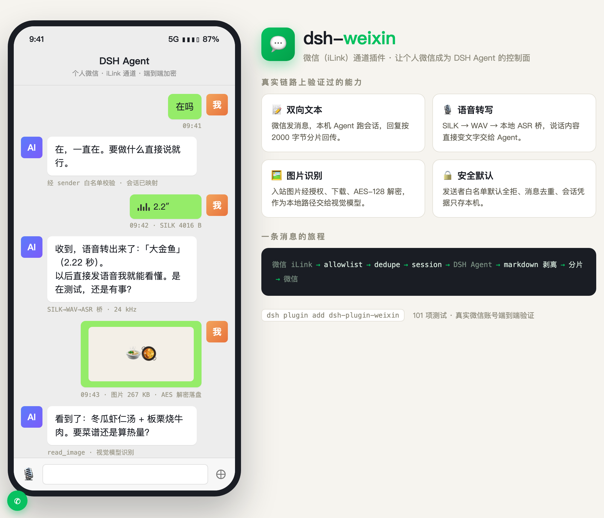
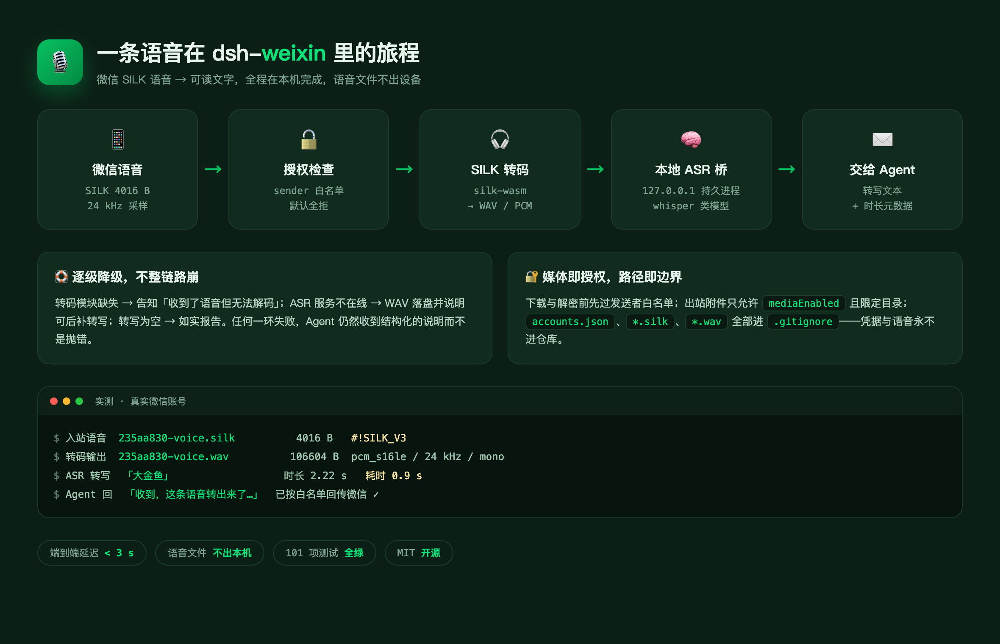

# dsh-plugin-weixin

<p>
  <b>简体中文</b> ｜ <a href="README.en.md">English</a>
</p>

[](https://www.npmjs.com/package/dsh-plugin-weixin)
[](https://github.com/panqing0313/dsh-plugin-weixin/actions/workflows/ci.yml)
[](LICENSE)
[](https://dsh.market/)


把**个人微信**变成 DeepSeek Harness（DSH）的远程控制面：在微信里发一句话，DSH Agent 在本地开一个会话执行，把结果回给你。

- **你想在微信里干活** → [安装](#安装) → [登录](#登录) → [授权](#授权重要) ，三步之后就能发消息了。
- **想改行为** → [配置](#配置)（29 项，设置卡里也有同样的表）。
- **想知道某个版本改了什么** → [CHANGELOG.md](CHANGELOG.md)。
- **出问题了** → `npm run doctor`（11 项体检），再看 [文档](#文档) 里的排障顺序。

## 目录

- [亮点](#亮点) · [当前状态](#当前状态) · [目录结构](#目录结构)
- [安装](#安装) · [登录](#登录) · [授权（重要）](#授权重要) · [配置](#配置)
- [会话](#会话一个微信会话可以用多条-dsh-会话) · [出站附件](#出站附件插件发给你的图片视频文件) · [入站媒体](#入站媒体微信发来的图片文件语音视频)
- [定时提醒](#定时提醒remind-与设置卡) · [定时主动消息](#定时主动消息subscribe) · [消息流水](#消息流水messagejournal) · [本地回忆检索](#本地回忆检索recall) · [即时总结与导出](#即时总结与导出summary--export)
- [免打扰时段](#免打扰时段quiethours) · [统计页签](#统计页签stats) · [个性化与记忆](#个性化与记忆mode--remember--forget--memory) · [陪聊节奏与生活状态](#陪聊节奏与生活状态humanpacing--lifestate) · [记忆改口](#记忆改口remember-旧--新--自动纠错)
- [语言](#语言locale) · [模型路由](#模型路由chatprovider--sideprovider--memoryprovider) · [记忆模型](#记忆模型结构化档案--事件--人物小传--独立模型) · [表情图片](#表情图片stickerenabled) · [主动开口](#主动开口proactiveenabled) · [语音与视频](#语音与视频voiceoutbound--videoframes)
- [富内容](#富内容richcontent--codefilethreshold) · [危险工具提醒](#危险工具提醒toolnotices) · [群聊](#群聊groupchatenabled--groupreplywhen--groupsharememory) · [工具审计](#工具审计toolaudit) · [语音识别](#语音识别asr)
- [Markdown 处理](#markdown-处理) · [开发](#开发) · [发布](#发布) · [文档](#文档)

## 亮点

每个版本改了什么在 [CHANGELOG.md](CHANGELOG.md)；这一节只讲**现在**能做什么。

### 它现在能做什么

- **多微信账号同时接入** —— 不止一个微信号。设置卡里逐个扫码添加（或 `node bin/login.js --account work`），每个账号独立收发、独立长轮询，登录/退出/重登一个账号不影响其他账号；扫码完成后即时生效，**不需要重启 DSH**。
- **账号级白名单** —— 每个账号可以覆盖全局的 `allowedSenders` / `allowedChats`（设置卡里直接改，保存即重挂该账号）；留空则回退全局配置。谁能让你的 Agent 干活，按账号说了算。
- **会话按账号隔离** —— 每个账号的微信会话有独立的 DSH 会话线（`/new`、`/list`、`/use`），互不串上下文；新会话标题带 `备注名:` 前缀并镜像成宿主侧栏会话名，多账号一眼分得清；不需要的会话线随时删。
- **一键暂停** —— 某个账号先静默：Pause 立即停掉它的入站轮询（其余账号照常收发），Resume 无缝恢复，都不用重启。
- **语音开箱即用** —— 入站语音 SILK → WAV 本地转码，ASR 桥识别成文字交给 Agent（热调用约 300ms），识别不了自动降级存文件；音频附件也能转成语音气泡（`voiceOutbound`，默认**关**——实测 iLink 服务端会接受机器人语音 `ret=0` 但不投递，打开前请读[出站语音](#出站语音voiceoutbound)一节）。
- **管理都在设置卡，也在左侧栏** —— 账号、会话、29 项配置、语音模型、消息流水 / 统计 / 提醒 / 个性化 / 关于（版本/检查更新/项目链接）全部在 DSH 设置页的微信卡片里完成；**同一张卡片还挂在左侧栏的「微信」页**（`sidebar.panellist` 一行 + `main` 面板），不用翻设置就能看账号状态、消息流水与统计。配置项按界面语言显示（中文界面全中文；分组默认折叠，点开才展开字段）。

底层用的是微信 **iLink Bot API**（`ilinkai.weixin.qq.com`），传输层来自腾讯官方开源插件
[`@tencent-weixin/openclaw-weixin`](https://github.com/Tencent/openclaw-weixin)（MIT，2.4.10），
本项目把它 vendor 进 `vendor/openclaw-weixin/`，剥掉 OpenClaw 的耦合后直接绑定到 DSH 的 `agents` 服务。





## 当前状态

**已真机验证**：插件加载、扫码登录、长轮询收消息、白名单、去重、开 DSH 会话、读回复、分段回发、
“正在输入”、入站图片与文件、入站语音**识别成文字**（SILK → WAV → ASR，热调用约 300ms）、
**一个会话下多条 DSH 会话**（`/new`、`/list`、`/use`，切换保留上下文）、
**多账号登录与切换**（第二账号扫码后即时生效，不需要重启）。

**尚未验证**：长时间运行、多账号长期并发使用、群聊；**发送**视频（需要视频编码，当前支持发送
图片、文件与音频语音）；原生图像理解（入站图片以本地路径交给 Agent，由 Agent 用 `read_image` 打开——
这依赖当前模型与工具链，不是插件自身保证）。

## 目录结构

```
src/index.js            插件入口：name / inject / Config / apply
src/agent-bridge.js     微信会话 ↔ DSH agent 会话（create/resume + followup）
src/session-reader.js   从 session log 读回 assistant 回复与在跑的工具
src/transport/ilink.js  iLink 长轮询 + send + sendMedia + typing
src/security/allowlist.js  发信人/会话白名单（默认拒绝所有人）
src/message/{chunker,dedupe,markdown}.js  分段、有界去重、Markdown→纯文本
src/media/inbound.js    入站媒体：下载、解密、落盘、语音转码
src/media/outbound.js   出站媒体：路径白名单、附件引用识别、上传
src/media/asr.js        语音识别：常驻 ASR 桥客户端（降级而非抛错）
src/state.js            把凭证目录从 ~/.openclaw 重定向到 ~/.dsh/weixin
bin/login.js            扫码登录 CLI
bin/install.mjs         安装到指定 DSH profile
vendor/openclaw-weixin/ 腾讯官方 MIT 传输层（已剥离 OpenClaw 依赖）
```

## 安装

### 方式一：从 npm / git 安装（推荐给普通用户）

DSH 的插件页（侧边栏 **Plugins**）或 `plugin_manager` 工具可以直接从 registry 安装：

```
dsh-plugin-weixin
```

也可以填 git 地址或绝对路径。安装后 DSH 会自动把 bundle 挂上，重启生效。

当前已发布版本：[`dsh-plugin-weixin@0.9.10`](https://www.npmjs.com/package/dsh-plugin-weixin)。

- **0.8.0** —— **首联系人自动登记**：新账号扫码后第一条消息的发信人自动进该账号白名单并放行（此前新账号拒所有人，第二个账号扫码后像「死号」，日志里才有拒绝原因）；登录卡账号行下方新增白名单摘要（有名单列 id，没有则提示首条消息自动登记）。
- **0.7.0** —— 侧栏认账号：新会话标题带 `备注名: 前缀` 并镜像成宿主会话名；会话线删除放开（使用中/最后一条都能删）；设置卡新增**关于**页签：当前版本、检查更新（对比 npm registry，网络不通会明说）、项目链接与数据位置。
- **0.6.0** —— **产出文件自动送达**：agent 在回合中写进工作目录的文件（截图、转换的 PDF 等）即使回复里没提到，也会直接发到微信（`autoSendFiles` 可关）；**模型调用失败不再卡住会话**：失败原因立即回给你，下一条消息马上正常处理（此前会空等 20 分钟并把后续消息全部压在队列里）。
- **0.5.0** —— 新增 `/clear` 清空当前会话并重开；出站附件收件人在转接处被丢成 `to=undefined` 的修复（自 0.1.0 起插件驱动的附件上传一直如此失败）；入站长轮询 body 挂死的看门狗（手机显示「暂无法连接 openclaw」的根因）；PDF/Word 等文档以 markdown 链接写出时也能送达；schema 默认值不再覆盖设置页保存的 ASR 命令。
- **0.4.0** —— 一个微信会话可挂多条 DSH 会话（`/new`、`/list`、`/use`，切走不销毁）；**全部配置项都能在设置页里看和改**；会话列表里给本插件开的会话加微信图标；二维码不再依赖 python 或未声明的包（Windows 修复）；出站相对路径按 agent 工作目录解析。
- **0.3.0** —— 仓库自带 ASR 桥，语音识别开箱可用（详见[语音识别](#语音识别asr)）。
- **0.2.0** —— 忙时排队/插话、超时补发、来源块、设置卡进入宿主 Settings。
- **0.1.0 / 0.1.1** —— 首发：扫码轮询、登录后自动起入站循环、白名单合并、归档会话自动恢复。

### 方式三：`npx`（不需要先 clone）

```bash
npx dsh-plugin-weixin            # 装进默认 profile
npx dsh-plugin-weixin --profile desktop
```

包里的 `bin` 指向同一个 `bin/install.mjs`，所以 `npx` 和从源码跑是同一条路径。

### 方式二：从源码安装

```bash
git clone <this-repo> && cd dsh-plugin-weixin
node bin/install.mjs                      # 默认装到 $DSH_PROFILE（或 desktop）
node bin/install.mjs --profile web        # 装到别的 profile
node bin/install.mjs --uninstall
```

脚本做三件事：

1. 把包（含 `vendor/`）放进 `<profile>/node_modules/dsh-weixin`；
2. 在 `<profile>/package.json` 的 `dsh.profile.bundles` 里追加 `dsh-weixin`；
3. 追加一行 `dsh-weixin` 到 `<profile>/cordis.patch.yml`（幂等，已存在则刷新那一行）。

同时会把两个**可选**依赖（`qrcode-terminal`、`silk-wasm`）搬到 profile 的 `node_modules`——
不搬的话它们只在这个仓库里可见，装到 profile 后会静默降级。

> **注意：这份安装能活多久，取决于 profile 里声明的版本。**
>
> - 声明的范围和装进去的版本**一致**时，App 启动时的 `pnpm install` 认为无事可做，副本保留（本地改过的文件不会被覆盖）；
> - 声明的范围**变了**（例如 profile 还写着 `^0.9.3`、你却装进了 0.9.5），它会从 registry 装回声明范围里的版本，手工复制的源码整个被覆盖——新增的文件直接消失，表现就是「重启前后功能不一样」，侧边栏入口就是这么消失过一次。
>
> 想让安装长期稳定，加 `--pin`：
>
> ```bash
> node bin/install.mjs --profile desktop --pin
> ```
>
> `--pin` 把 profile 的 `dependencies` 指向当前这份代码的版本（`^<version>`），并用 App 自带的那份 pnpm 刷新锁文件。它只在**已发布版本**上有意义：源码版本号还没发布时，pin 过去只会让 pnpm 找不到包——那种情况先用临时副本验证，发版之后再 `--pin`。非 caret 的声明（比如 `file:...tgz`）不会被改写，只提示。

重启 DSH 后生效。

## 登录

```bash
node bin/login.js                    # 终端打印二维码，手机微信扫码
node bin/login.js --account work     # 多账号时指定 id
node bin/login.js --force            # 已有账号时强制重新扫码
```

凭证写入 `~/.dsh/weixin/openclaw-weixin/accounts/<id>.json`，权限 `0600`，**只在本机**。
`bin/login.js` 不接收密码，也不会把 token 打印到日志（vendor 自带 redact）。

### 在 DSH 设置页登录

「设置 → 插件 → dsh-plugin-weixin」里也能直接扫码，不用开终端：

- 点「扫码登录微信」后，卡片显示**真正的二维码图片**（host 端把 iLink 返回的登录链接渲染成
  PNG 再回传，客户端不需要任何二维码库）；
- 二维码在**任何平台**都能画出来，不需要装 python、也不需要额外装包：二维码矩阵取自
  `qrcode-terminal`（本就是依赖），PNG 由 `src/png.js` 只用 `node:zlib` 手工编码。
  早先的实现先找 npm `qrcode`、再找 `python3`——前者从来不是依赖、后者 Windows 上根本没有，
  所以 Windows 用户看到的是一个**破图图标**而不是二维码。现在这条路被测试钉死了；
- 万一真的画不出图，卡片会**说明「二维码图片不可用，请点下面的在浏览器打开」**，而不是把
  登录链接塞进 `` 显示一个破图；
- 二维码旁边有「在浏览器打开」和「复制链接」——iLink 返回的 `qrcode_img_content` 其实是一个
  **登录链接**（`https://liteapp.weixin.qq.com/q/...`），不是图片；链接在浏览器里打开同样能扫码；
- 需要验证码时卡片会切到输入框，提交后继续轮询；二维码过期会自动刷新（最多 3 次）。

### 退出登录与重新绑定

「退出登录」只删除**本机**凭证。iLink 没有服务端解绑接口，机器人仍挂在微信侧（手机微信里仍显示
「已绑定」），所以：

- 退出登录后卡片显示「未登录」是**如实显示，不是状态不实时**——本机确实已经没有任何凭证。
  卡片的状态由本地账号文件决定，手机上的「已绑定」说的是服务端绑定关系，两者本来就不是一回事；
- 如果你在这次退出登录之前用设置页扫码，那个流程**从来没有走通过**（轮询一直在 `poll(null)`，
  见 `docs/progress.md`）。也就是说：扫码后卡片停在二维码页、扫码结果无人处理，与手机显示
  「已绑定」无关。修复后重新扫码才会真正走到服务端；
- 走到服务端之后还有一种情况：服务端仍认为这台机器绑定着同一个机器人时，会回 `binded_redirect`
  并**拒绝下发新凭证**（此支语义取自 vendor 源码；vendor 的 CLI 把它读成幂等成功
  「已连接过此 OpenClaw，无需重复连接」，但那只在**本机仍持有 token** 时才成立，退出登录后 token
  已经没了，本机也没有任何接口能解绑）；
- 卡片会把这种情况单独报成「需要处理」，并给出唯一可行的动作：**先在手机微信里解除该机器人的绑定**，
  然后重新扫码。

即：退出登录 = 本机忘记；要重新绑定 = 手机上先解绑。

### 扫码成功后不需要重载 DSH

插件刚加载时如果本机还没有凭证（全新安装，或刚退出登录），收消息的 `getUpdates` 长轮询在那时
是**无法启动**的。设置页扫码成功后，登录会通知宿主立刻为**刚写入的凭证**把这条循环拉起来，
所以「扫码 → 重载 DSH → 才通」这个多余步骤已经没有了。

如果手机微信仍提示「暂时无法连接 openclaw」，按顺序看四处：

1. 插件日志里有没有 `listening as account <id>`——没有就是循环没起来；
2. 有没有 `settings login service unavailable`——有就说明登录服务没装上，扫码**能**成功、
   凭证**会**写盘，但没有任何人在听「登录已完成」，循环不会切到新凭证（历史上这一行曾把
   `ctx.plugin()` 的误用吞掉，症状与「循环没起来」完全相同）；
3. 有没有 `no Weixin account is saved`（凭证不在）或 `is already being listened to`（重复触发，正常）；
4. 凭证是否被服务端拒绝：`getUpdates errcode=-14` 表示登录已过期，需要重新扫码。

换绑到新机器人（token 变了）时，插件会**先停掉旧的长轮询再启动新的**：同一凭证上跑两条长轮询会让
服务端把入站消息**分摊**给两条循环，而不是各收一份。

### 多账号管理

多个账号可以同时登录（`node bin/login.js --account work` 逐个添加，或在设置卡点
**新增账号登录**逐个扫码）。每个已保存的账号都有**自己的入站循环**：一个账号的
凭证过期、登录或退出，不影响其他账号的收发。会话也按账号隔离——同一个微信会话
在两个账号下是两条独立的会话线，`/list`、`/use` 只作用于收信账号自己的线。

「设置 → 微信」的登录卡会列出每个账号一行：备注名（或账号 id）、最近活跃时间
（「刚刚 / N 分钟前 / N 小时前 / N 天前」）、暂停标记，以及三个操作：

- **Rename** —— 给账号起个备注名（如「工作号」），只影响显示，存本机
  `~/.dsh/weixin/accounts-registry.json`。编辑在卡片内完成：点「改名称」后账号行
  下方出现输入框，**保存**生效、**取消**放弃（桌面端弹不出浏览器式 prompt，所以
  是内联编辑，不是弹窗）；
- **Allowlist** —— 给这一个账号单独设置允许的发送者（逗号分隔，预填当前生效
  列表）。留空 = 清除覆盖、回退全局白名单；改动**立即生效**，不需要重载。生效
  规则是账号覆盖优先于全局 `allowedSenders`；
- **Pause / Resume** —— 暂停一个账号的收信（凭证保留，手机上仍是绑定状态）。
  暂停**立即生效**，不需要重载；被暂停的账号在日志里有明确一行
  （`account "<id>" is paused; not starting its loop`），刻意静音不会被误读成故障；
- **Log out** —— 只退出这一个账号，其他账号照常收发。

登记表是纯元数据：文件损坏最多丢备注和暂停标记，绝不影响消息收发。

## 授权（重要）

微信文本**不是**授权凭据。因此：

- `allowedSenders` 默认**空**，等于拒绝所有人——没配白名单的插件什么都不驱动；
- 不在白名单的发信人只记一条 warn，不创建会话、不回消息；
- **首联系人自动登记**：账号自己的白名单为空（没在卡片里配过、也没登记过）时，收到的第一条消息的发信人会被当作扫码人本人，自动写进该账号的白名单并放行这一条——扫码时只知道 bot id，人的微信 id 要到第一条消息才出现。之后的其他陌生人照旧拒绝；要加人可在设置卡片改，或清空重来；
- 真实的文件修改/命令执行仍由 DSH 自己的权限层与确认流程决定，本插件不旁路。

## 配置

`cordis.patch.yml` 里那行的 `config`：

| 字段 | 默认 | 说明 |
| --- | --- | --- |
| `enabled` | `true` | 关闭即不启动长轮询 |
| `accountId` | `''` | 空 = 只用唯一已保存账号 |
| `cwd` | `''` | Agent 工作目录；空 = 继承会话默认 |
| `allowedSenders` | `[]` | 允许驱动 Agent 的微信用户 id |
| `allowedChats` | `[]` | 会话白名单；空 = 不限制会话 |
| `maxMessageLength` | `1500` | 单条出站消息字符上限 |
| `sendIntervalMs` | `1200` | 两条外发消息（文本分片和附件都算）之间的最小间隔，毫秒。实测约 20 条/几分钟会触发账号级发送封锁（≥30 分钟），该间隔让分片回复保持在线以下 |
| `sendCooldownMs` | `30000` | 连续 3 次发送失败后的冷却时长（毫秒），避免把临时拒绝升级成账号封锁 |
| `readLinks` | `true` | 消息含 http(s) 链接时抓取网页正文给 Agent 参考；打不开的链接只报一行原因，不影响消息 |
| `messageJournal` | `true` | 把最近的收发消息记入本地流水，设置卡「消息流水」页签展示最近 50 条 |
| `personaDefaultMode` | `'default'` | 新会话默认的对话模式。设置卡「个性化」页签的「默认模式」选择器会实时覆盖它（存盘即生效，不需要重载） |
| `memoryEnabled` | `true` | 把长期记忆、会话摘要与最近消息窗口折进提示词。关掉后 /remember、/forget、/memory 一并停用；/mode 是独立功能，不受影响 |
| `memorySummaryTurns` | `10` | 每多少个已完成的 agent 回合，后台自动把这段会话的摘要更新一次 |
| `memoryGlobalMaxFacts` | `30` | 长期记忆条数上限；存满后 /remember 会拒绝新增，而不是悄悄挤掉最旧的一条 |
| `memoryConvMaxChars` | `1200` | 会话摘要的字符上限 |
| `memoryProvider` | `''` | 记忆模型 provider（摘要 / 抽取 / 整理用）。留空则沿用当前会话的模型 |
| `memoryModel` | `''` | 记忆模型 model，和 provider 一起填才生效 |
| `memoryRecentTurns` | `5` | 冷启动时补多少条最近消息：只在**新会话线**（首条消息、`/new`、`/mode` 切换）注入一次，已接上的会话不再重复。0 关闭 |
| `memoryRecall` | `true` | 消息提到旧事时在本地流水里检索原文并折进提示词；闲聊命中不到不花 token |
| `memoryRecallDays` | `180` | 本地回忆检索往回找多少天（更早的流水仍在磁盘上，只是不进索引） |
| `memoryRecallHits` | `3` | 一次最多注入几条命中原文（每条截 140 字） |
| `humanPacing` | `true` | 陪聊模式的「像人一样回」：首条延迟 + 长回复拆成多条气泡。只对非「默认助手」模式生效 |
| `replyDelayMaxMs` | `2400` | 首条回复最多停顿多久（毫秒）：实际停顿随回复长度与当前精力浮动，累的时候更慢 |
| `bubbleSplitMax` | `3` | 一条长回复最多拆成几条气泡（1 = 不拆）。单句短回复永远只发一条 |
| `bubbleGapMs` | `700` | 两条气泡之间停多久（毫秒），实际值在 0.7–1.3 倍之间抖动 |
| `lifeState` | `true` | 按时间推断心情 / 在做什么 / 精力，折进提示词让语气跟着状态走（5 分钟节流落盘，不进模型） |
| `stickerEnabled` | `true` | 允许模型写 `[表情:开心]` 换一张表情图发出（图片气泡）。关掉后连这个标记都不教给模型 |
| `proactiveEnabled` | `false` | 陪聊模式下「先开口」：对方一段时间没说话时由它主动发一条。**默认关**，只对非「默认助手」模式生效 |
| `proactiveMinGapMinutes` | `180` | 距对方最后一条消息至少这么久才主动开口；也是没被回应时退避的基数（每次翻倍，最多一天） |
| `proactiveMaxPerDay` | `3` | 每个账号每天最多主动发几条 |
| `proactiveWindowStart` | `'09:00'` | 主动开口的时段开始（本地 `HH:mm`），窗外一律不发；填反会回落到默认时段 |
| `proactiveWindowEnd` | `'23:00'` | 主动开口的时段结束（本地 `HH:mm`），必须晚于开始 |
| `quietHoursEnabled` | `false` | 免打扰开关：开着时落在时段内的定时提醒与 /subscribe 主动消息都推迟到时段结束后再发（重新排期，不丢、不重复） |
| `quietHoursStart` | `'23:00'` | 免打扰开始（本地时间 `HH:mm`）。必须严格早于结束（或跨午夜），两端相等视为未配置 |
| `quietHoursEnd` | `'07:00'` | 免打扰结束（本地时间 `HH:mm`）。跨午夜时段（如 23:00 → 07:00）按两段计算 |
| `groupChatEnabled` | `false` | 参加群聊。默认关闭：对每条群消息都答的机器人，在真群里就是刷屏；私聊不受影响 |
| `richContent` | `true` | 富内容：长代码块改发文件（缩进/语言/行数都在）、Markdown 表格转成对齐文本 |
| `videoFrames` | `true` | 收到视频时用本机 ffmpeg 抽三帧静图交给模型（模型读不了视频，但能看图） |
| `codeFileThreshold` | `1200` | 代码块超过多少字改发文件；更短的留在气泡里 |
| `groupReplyWhen` | `'mention'` | 群里什么时候回：`mention` 只答被叫到的时候，`all` 每条都答 |
| `groupShareMemory` | `false` | 群里是否也注入长期记忆、回忆片段与亲密度行。默认关闭——那些块是主人自己的私事 |
| `toolAudit` | `true` | 把 agent 每次工具调用追加到 `<状态目录>/audit/`（按天一个 JSONL）：工具名、截断到 500 字符的参数、哪个账号/会话/发送者触发、结果是否带错 |
| `voiceOutbound` | `false` | 音频附件按微信语音发出而不是文件（wav/silk 进程内转码，其余走 ffmpeg）。**默认关**：实测服务端接受机器人语音（ret=0）但不投递，开着会让附件无声消失；发送被拒时仍会自动降级为文件 |
| `markdownMode` | `'strip'` | 回复的 Markdown 处理：`strip` 转微信可读纯文本，`off` 原样发送 |
| `progressAfterMs` | `45000` | 超时前发一条进度提示 |
| `maxTurnWaitMs` | `1200000` | 等待一轮的上限 |
| `typingIndicator` | `true` | 有 typing ticket 时显示“正在输入” |
| `mediaEnabled` | `true` | 把回复里引用的本地文件作为附件发出（出站） |
| `maxMediaBytes` | `104857600`（100MB） | 出站附件大小上限 |
| `maxInboundMediaBytes` | `20971520`（20MB） | 入站附件下载大小上限 |
| `cdnBaseUrl` | 空（未配置） | 入站下载与出站上传的 CDN 根。留空表示「这里没配」：会先用账号记录里的 `cdnBaseUrl`，再退回上游默认 `https://novac2c.cdn.weixin.qq.com/c2c` |
| `asr.modelDir` | `''` | 语音模型目录；空 = `~/.dsh/weixin/asr-models`。设置页的输入框会覆盖它（并写进 `<stateDir>/asr-config.json`） |

改完配置重载插件即可。

**这些选项现在都能在设置页里改**：打开「设置 → 微信」的 **配置项** 标签页，逐项编辑、
保存。表单直接读插件自己的 schema，所以每个选项都带默认值、当前值和它从哪来
（`default` / 来自 `config` / 已保存），改动过但没保存的项会标出来。保存只写你改过的那几项，
写入 `~/.dsh/weixin/config.json`（与凭证放在一起，重装插件不会丢）。

优先级：**界面保存的值 > `cordis.patch.yml` 里的 `config` > schema 默认值**。
想放弃某次修改，点该项的「恢复默认」。

只有两项在界面上是只读的：

- `maxTurnWaitMs` —— 调低它会静默截断长回复，不适合当日常开关；
- `enabled` —— 它是插件的总开关，改它请改 YAML（关掉后设置页仍然可用，
  方便你先配好再打开）。

**产出文件自动送达**：Agent 在回合中写进工作目录的文件（截图、转换的文档、导出的数据等）
在回复送出后自动发到微信，不需要再发一条「发我微信」——即使回复文本没有引用这些文件。
只认可投递的扩展名（图片/文档/音视频），不递归子目录；`mediaEnabled` 关闭时同样不生效。
设置页「媒体 → 产出文件自动送达」可关闭。


## 会话（一个微信会话可以用多条 DSH 会话）

一个微信会话默认只对应一条 DSH 会话，聊久了上下文会一直变长。插件支持**会话线**：
同一个微信会话下可以有多条 DSH 会话，每条有自己的上下文，互不影响。

在微信里直接发命令（整条消息恰好是命令才生效，`看看 /new 这个命令`、`/steer /new` 都不算）：

| 命令 | 作用 |
| --- | --- |
| `/new` | 开一条新会话，接下来的消息进入它 |
| `/list` | 列出当前会话下的所有会话线，`▶` 标出正在用的那条 |
| `/use <序号>` | 切到第 N 条（序号来自 `/list`） |
| `/clear` | 清空当前会话并重新开始：这条线从 `/list` 里移除，立刻开一条全新的 |
| `/cancel` | 中断**正在跑的那一轮**（长任务卡住时用）。已经排队的消息仍会继续；回复会被记成「已取消」而不是「模型调用失败」 |
| `/status` | 查看当前账号和会话状态：账号名、是否暂停、最近收发、白名单人数与来源、会话线数 |
| `/remind <时间> <内容>` | 定时提醒：到点后机器人直接把内容发到当前会话（如 `/remind 10m 站会`、`/remind 18:30 下班打卡`、`/remind 2026-10-20 09:00 交周报`） |
| `/remindlist` | 列出本账号还没触发的提醒（含编号） |
| `/remindcancel <编号>` | 取消一条还没触发的提醒 |

**切换是保留的，不是重置**：切走的那条不会被结束或清空，切回来时它之前的上下文原样都在。
`/list` 里的序号是**绝对序号**（从 1 数起），所以即使只显示最近 10 条，序号也不会因为折叠而错位。

`/clear` 是唯一会丢上下文的命令，所以它只作用于「当前正在用的那条」且不带参数——
`/clear 3` 这类写法不会被识别。被清掉的那条只是从会话线列表里移除，之后 `/use` 也切不回去；
宿主那边的会话文件原样保留，不删任何历史记录。

命令由插件直接回，**不消耗模型对话**：发 `/new` 不会在会话里留下一轮问答。

两条已确立的事实：

- **升级不会丢上下文**。第一条会话线沿用历史 id（`weixin-<会话 slug>`），装了新版本后老会话仍然是那条；
- 存放位置是 `<stateDir>/sessions.json`（默认 `~/.dsh/weixin/sessions.json`），删掉它等于只保留一条默认会话线。

### 在设置页管理

DSH 设置页的插件卡片里有「会话」标签：列出每个微信会话下的会话线、标出正在用的那条，
并可以点「切换」跳到某一条——不用回到微信里敲 `/use`。每条会话线都有
**「删除」** 按钮（确认后生效）：只从列表移除那一条线，其他线不受影响；删除正在使用的线时，
自动回退到剩下第一条；删掉最后一条线等于移除整个会话条目，下一条消息会自动新建一条干净的
会话线。每个会话条目上还带**账号标识**（多账号各自的备注名或账号 id），一眼区分哪条会话属于
哪个账号；升级前的历史会话（不带账号前缀）不显示标识。改动实时生效，不需要重载。
卡片只读该文件，改的也是它，和微信里发命令是同一条路径，所以两边看到的永远一致。

### 会话列表里怎么认出微信会话

工作区左侧的会话列表里，**本插件开的会话**行首会带一个微信图标（14px，微信品牌绿 `#07C160`），
一眼能从别的会话里分出来。

多账号下，会话线的**标题本身**就带账号标识：新建的会话线标题形如
`备注名: 第一条消息`（没有备注名时用账号 id 短形式），侧栏、`/list` 和设置卡片看到的是同一
份标题，不需要额外的行内标记。升级前的历史会话标题保持原样，不带前缀。这条标题还会在
第一条消息时**同步写入宿主会话**（`sessionTitle.rename`，user 来源钉住），所以宿主侧栏
显示的也是这条 `备注名: 消息`，而不是宿主自己起的 AI 标题；此后宿主不再自动改名。

判定只看会话 id 的前缀 `weixin-`：本插件开的是 `weixin-<会话 slug>`，同一会话的第二条线是
`weixin-<会话 slug>--<时间戳>`；别的会话用的是 DSH 自己的 `session-<uuid>`，不会被错标。

这个图标挂在宿主声明的槽位 `sidebar.session.row.leading` 上。该槽位由 ui-workspace 提供给
**每一行**会话，只在行处于 idle 时渲染，归档行留空，搜索结果没有这个位置；宿主自己的定时任务
时钟（ui-schedule）也占这个位置——本插件用**独立的座位 id**，所以两者能共存，不会互相顶掉。

对不是本插件开的会话，组件返回 `null`——一个像素都不占，也不会给别人的会话贴上微信图标。

多账号下，图标旁边还会有一段**很淡的归属提示**：这行会话属于哪个微信账号，取设置页里给
账号起的备注名（没起就用账号 id），最多显示 6 个字符、超出带省略号。归属来自卡片同一份
`/api/weixin/sessions` 数据，所以只有能对上某个账号的会话才显示；升级前的历史会话对不上号，
保持只有图标。提示和图标一样是装饰性的，不参与布局之外的任何行为。

## 出站附件（插件发给你的图片/视频/文件）

Agent 在回复里**引用本地文件**时，插件会把文件上传并作为附件发出。认哪些写法取决于**扩展名**：

```markdown
              ← 图片语法，任何扩展名都认

     ← 路径有空格时用尖括号包起来
[报告](报告.pdf)               ← 链接语法：只对「天然就是附件」的扩展名生效
报告.pdf                       ← 单独成行/列表项的相对路径：同样是附件类才认
/abs/path/a.pdf                ← 单独成行的绝对、~/、C:\ 路径：任何扩展名都认
```

**不引用也会送达**（`autoSendFiles`，默认开）：agent 在回合中写进其工作目录的文件——
桌面截图、转换好的 PDF、导出的数据——在回复送出后会自动发到你微信，即使回复文字里
完全没提到它。边界：只扫工作目录第一层（`tools/`、`crops/` 等子目录不卷入），只送
可投递的扩展名，每回合最多 5 个、新者优先；回复里已引用过的文件不重复发送；设置页
「媒体 → 产出文件自动送达」可关。

**为什么分两种待遇**：微信回复里没有任何东西会内联渲染一个 PDF，所以 `[报告](报告.pdf)` 只可能
是「把文件发我」；但 `[截图](icon.png)` 可能只是 agent 在**指路**，把它当上传会把无关图片甚至源码
树发出去。附件类的完整名单见 `ATTACHMENT_EXT`（`src/media/outbound.js`）：`pdf doc(x) xls(x)
ppt(x) csv zip tar gz 7z rar mp3 wav m4a ogg mp4 mov webm mkv avi silk`。

这些**不**认：行内代码与代码块里的路径（那是在**展示**语法）、行内正文里的裸路径（如「文件在
/tmp/a.pdf 里」）、``（未用尖括号包裹）、`https://` 之类的网络图片——网络图片
本来就不该由插件上传。

发出的形式按 **MIME** 决定（不是扩展名）：

| 类型 | 扩展名 | 你会收到 |
| --- | --- | --- |
| 图片 | `.png` `.jpg` `.jpeg` `.gif` `.webp` `.bmp` | 图片消息 |
| 视频 | `.mp4` `.mov` `.avi` `.mkv` `.webm` | 视频消息 |
| 其他 | 其余一切（含 `.pdf` `.zip` `.docx`，也含 `.svg` `.heic` `.m4v` `.wav`） | 文件附件 |

注意第三行：`getMimeFromFilename` 不认 `.svg` `.heic` `.tif` `.avif` `.m4v` `.3gp` `.flv` `.wmv`，
它们会**降级成文件附件**——能收到，但没有原生图片/视频气泡。想要原生效果，挑第一、二行的扩展名。

单文件上限 **100MB**（`maxMediaBytes` 可调），一条回复最多 5 个附件。发不出去时不会吞掉回复：
失败原因会作为一行附在文字后面。

文件必须在**允许的目录**里：agent 会话的工作目录，或 `~/.dsh/weixin`。路径经 `realpath` 后再判包含，
符号链接指向目录外也会被拒，`..` 逃逸按原文判定。放宽「引用识别」不改变这个边界——识别只决定
「要不要尝试发」，能不能读始终由目录检查决定。详见 `docs/security.md`「出站附件」。

### 出站语音（voiceOutbound）

音频附件（`.wav`/`.silk`/`.mp3`/`.m4a`/`.aac`/`.ogg`/`.opus`/`.flac`…）可以按微信**语音气泡**发出而不是文件：wav/silk 在进程内转码成 SILK（24 kHz，其余采样率线性重采样），其余格式调 `ffmpeg` 解码。发送被服务端**拒绝**时自动降级为普通文件附件，音频只会降级、不会丢。

但默认是**关**的，原因要说实话：两次实测（2026-06、2026-10-26，后者带着全新 `context_token`、上传与 `sendmessage` 均成功返回 `ret=0`）显示 **iLink 服务端会接受机器人的 `voice_item` 却不投递给收件人**——消息被服务端静默吞掉，这大概率是账号侧的语音/TTS 能力开关。所以：

- `voiceOutbound: false`（默认）→ 音频附件按文件发，稳定送达；
- `voiceOutbound: true` → 尝试语音气泡；如果腾讯哪天放开了投递，气泡就会正常出现，风险只是附件可能无声消失。

哪天想试，打开开关让 agent 发一段音频，然后看 `~/.dsh/weixin/logs/openclaw-*.log` 里的 `sent voice media … (server ret=…)` 行：`ret=0` 且手机上没有 = 仍未投递。

## 入站媒体（微信发来的图片/文件/语音/视频）

用户发来的媒体会**先过白名单和去重，再**从 CDN 下载——未授权的发信人不会让本机对 CDN 发起任何请求
（`test/e2e.test.js` 里有一条断言守着这点）。下载后按 AES-128-ECB 解密，存到
`<stateDir>/media/inbound/`（默认 `~/.dsh/weixin/media/inbound/`），再把**本地绝对路径 + 用哪个工具读**
拼进交给 Agent 的 prompt：图片提示 `read_image`，文件/视频提示 `read`。微信图片带的 caption 会一并
保留，所以 Agent 既有图也有问题。

两个安全要点：

- **对端给的文件名绝不用来拼路径。** 文件名先取 basename、去掉分隔符与 `.`/`..` 段，再加随机前缀，
  写盘用 `wx` 独占模式。`../../etc/passwd` 只会变成 `a1b2c3d4-passwd` 落在收件目录里，逃不出去。
- **大小先按 `Content-Length` 判、读完再按实际字节判一遍。** 头部可以缺、也可以撒谎，两道都要过。

失败**不静默**：下载失败会把具体原因回给用户（如 `CDN returned 403`、`30.0MB，超过 20.0MB 上限`），
而不是笼统的「暂不支持」。真正未知的 item 类型（如 `TOOL_CALL_*`）才保留「暂不支持」提示。

### 消息里的链接（readLinks）

`readLinks` 开着时（默认开），消息里出现 http(s) 链接会自动抓取网页正文、剥掉 HTML 后拼进交给 Agent
的 prompt（最多 3 条，每条正文上限 20000 字符，原始响应上限 512KB）。于是「这篇文章说了什么」能被
直接回答，而不是「我打不开链接」。抓取是尽力而为：只碰 http(s)；二进制内容（图片/音视频）不当作文本
硬读；抓不到的链接只给 Agent 一行原因（`HTTP 500`、`请求失败：…`），消息本身照常走完一轮。
`test/links.test.js` 与 `test/e2e.test.js` 的 readLinks 用例守着这些行为。

### 定时提醒（/remind 与设置卡）

微信里用 `/remind 10m 内容`、`/remind 18:30 内容` 或 `/remind 2026-10-20 09:00 内容` 安排，
`/remindlist` 查看、`/remindcancel <编号>` 取消。设置卡的「定时提醒」页签显示全部账号的待发提醒
（到点时间、内容），可直接点「取消」——立即生效，不需要去微信里发命令。提醒到点由插件直接发出
（「（提醒：内容）」），不消耗模型调用；到点时对应账号离线则丢弃并警告（重启后不补发过期的）。
`test/scheduler.test.js`、`test/reminders-ui.test.js` 与 e2e 的 reminders 用例守着这些行为。

### 定时主动消息（/subscribe）

`/remind` 到点发固定文字、零模型消耗；`/subscribe` 则是**到点让 agent 现场生成一条再发**——
带上当前人设、记忆和最近对话，所以早安问候会用你选的模式口吻说，周报会聊你们这周聊了什么：

- `/subscribe 每天 08:00 早安，问问我睡得怎么样`、`/subscribe 每周日 21:30 聊聊这周`、
  裸 `HH:mm` 等于每天；一次性时间（`10m`、`2026-11-01 09:00`）只发一次后自动移除。
- `/subscribelist` 查看（最近的在前）、`/subscribecancel <编号>` 取消；每个账号最多 20 条。
- 错过的到点：循环订阅在 30 分钟内补发一次，超过就不发（不排队轰炸）；一次性到期直接丢弃。
  到点时对应账号离线同样不补发。生成走独立侧会话，完成前不占用正常对话。
`test/subscriptions.test.js` 与 `test/session-commands.test.js` 的 /subscribe 用例守着这些行为。

### 消息流水（messageJournal）

`messageJournal` 开着时（默认开），每条收发的文本消息都会追加到本地流水（`<状态目录>/journal/`，
按天一个文件，文本截断 200 字符）。设置卡的「消息流水」页签显示最近 50 条（收 ↓ / 发 ↑、账号、时间、
内容，最新在前），不用翻日志就能确认每个账号都活着。写流水是尽力而为：失败只 warn，绝不影响消息收发。
页签顶部有 **导出记录** 按钮：把最近 30 天渲染成 Markdown 由卡片直接下载，不经过服务端文件。
`test/journal.test.js` 与 `test/e2e.test.js` 的 messageJournal 用例守着这些行为。

### 本地回忆检索（/recall）

消息流水本来就把每条消息留在本地，缺的只是「查得到」：摘要是有损的，事实是手工整理的。
`memoryRecall` 开着时（默认开），每条消息会先在本机检索一次流水——中文按二元切片、英文按词，
BM25 打分，索引落在 `<状态目录>/memory/index/<账号>.json`，按天文件增量追加，只覆盖最近
`memoryRecallDays` 天（默认 180，更早的流水仍在磁盘上，只是不进索引）。

只有**值得查**的时候才花 token：消息里出现「上次/之前/那天/我说过」这类词，或者词面命中够密
（≥2 个词且分数过线）时，才把 **3 条（`memoryRecallHits`）带日期的原文**折进 `<weixin_recall>`
块；闲聊命中不到就什么都不注入，0 token。当前这条消息、以及 `/recall` 这类指令本身不会命中自己。

`/recall <关键词>` 手动翻记录：直接回带日期的原文，**不经过模型、不花 token**；本会话找不到
再扩大到整个账号（你常常记不清是在哪个对话里说的）。`test/recall.test.js`、`test/session-commands.test.js`
的 /recall 用例与 e2e 的 local recall 用例守着这些行为。

### 即时总结与导出（/summary · /export）

- `/summary` 让侧会话**现场**把这段会话总结一遍（聊到哪、定了什么、还有什么待办、彼此的约定，
  不超过 300 字）。它只回复你，**不写回会话摘要**——想记住的交给自动摘要，这一步是「看一眼」。
  有对话正在跑时会回「等这轮结束再试」，不会打断正在进行的回合。
- `/export [天数]` 把最近 N 天（默认 30）的聊天记录渲染成 Markdown：短（≤3000 字）直接作为
  消息回复，长记录写到 `<状态目录>/exports/chat-<账号>-<会话>-<时间>.md` 并告诉你路径。
  设置卡「消息流水」页签的导出按钮走同一条渲染，只是改为浏览器下载。
`test/chat-export.test.js` 与 `test/session-commands.test.js` 的 /summary、/export 用例守着这些行为。

### 免打扰时段（quietHours）

`quietHoursEnabled` 打开后，`quietHoursStart`～`quietHoursEnd`（默认 23:00–07:00，支持跨午夜）
之内到点的 `/remind` 提醒和 `/subscribe` 主动消息**推迟到时段结束再发**：提醒保留在磁盘上重新排期，
订阅不消耗次数、顺延后再触发。这样夜里不会响，早上消息也不会丢。时段两端相等视为「没配置」
（否则等于永远静音，会把所有定时消息吞掉）。`test/quiet-hours.test.js` 守着这些行为。

### 统计页签（stats）

设置卡的「统计」页签给最近 7/14/30 天的收发量：总量（收到 ↓ / 发出 ↑）、按天柱状、24 小时分布、
最活跃的几个会话。数字全部由本机消息流水**现算**（不缓存、不回传），所以和「消息流水」页签永远一致。
`test/stats.test.js` 与 `test/login-remote.test.js` 的 stats 用例守着这些行为。

### 日报与记忆核对（digestEnabled · memoryReviewEnabled）

到点主动发一条消息，不需要你先开口：

- **日报**（默认每天 21:00）：把当天的消息流水现算一遍 —— 收到/发出多少条、聊得最多的是哪个会话、还挂着哪些事件待办 —— 然后由侧会话写成三到五句自然的总结。**数字全部来自流水**，提示词里明确禁止编造没出现的对话。
- **记忆核对**（默认每周日 20:00）：把记着的事编号列出来（档案、人物小传、最多 8 条事实），问一句「有哪条不对吗」。改法还是那两条命令：`/remember 旧的 → 新的` 改口，`/forget 编号` 删掉。**核对本身从不改记忆** —— 自动改口已经存在，但让模型在半夜替主人重写记忆是另一回事。

发送目标是「最近说过话的那个会话」；两边都只发一条消息（不是三条气泡），失败只在日志里留一行。时间用 `/subscribe` 那套写法：`每天 21:00`、`每周五 18:30`，写错就在当天不发并在日志里说明。想关掉：`digestEnabled: false` / `memoryReviewEnabled: false`。

`test/reports.test.js` 守着调度（只提前两秒算「到点」、一次只触发该触发的、抛错不影响下一轮）与两个提示词的关键约束。

### 指标与长稳（metricsExport · npm run metrics · npm run soak）

插件每 30 秒把内存里的计数器写成两份文件：`<状态目录>/metrics.json`（卡片和人都能读）和 `metrics.prom`（Prometheus 文本格式）。读它们不需要插件在跑：

```bash
npm run metrics                 # Prometheus 文本，带 dsh_weixin_snapshot_age_seconds
npm run metrics -- --format json
```

计数是**进程生命周期**的，重启归零 —— 这是刻意的：一个长期累积的计数器会掩盖「今天下午开始变慢」这类问题。文件末尾的 `snapshot_age_seconds` 让抓取端分得清「活着但没流量」和「根本没在跑」。

长稳用 `npm run soak`：它不驱动模型（那需要真宿主和真账号，CI 里跑不了），而是把会随日子累积损坏的部分压到远高于真实流量的速率 —— 消息流水、出站队列重试、记忆文件、保留策略、备份恢复 —— 并断言不变量：没丢消息、`outbox.json` 始终可解析、保留策略不碰非它创建的文件、跑完备份能校验且能恢复、RSS 不涨过三倍。任何一条破了就以非零退出。

### 备份与恢复（backupEnabled）

保留策略会**删**旧文件（流水 180 天、审计 90 天、媒体 30 天……），而在此之前没有任何东西替这些文件
留过副本。所以插件每天自动把状态目录备份一次到 `<状态目录>/backups/`（启动 5 分钟后第一份，之后每 24 小时），
保留最近 `backupKeep` 份（默认 3），更旧的自动删除。备份里包含什么？

- `config.json`、`accounts-registry.json`、`openclaw-weixin/accounts/`（**账号 token**）、`asr-config.json`
- `memory/`（长期记忆、档案、事件、人物小传、亲密度）、`persona-*.json`（模式与当前选择）
- `journal/`、`audit/`、`sessions.json` + `sessions/`（会话线与 agent 记录）、`reminders.json`、`subscriptions.json`、`outbox.json`、`config-scope.json`
- 不备份 `asr-models/`（约 900 MB 的模型缓存，能重新下载）、`logs/`（诊断用）、`media/`（默认不备份，`--with-media` 才带上）

**备份里有能直接登号的 token**，所以目录建成 0700、文件 0600，别把它传到云盘或聊天窗口。

```bash
npm run backup -- create                        # 立刻备份一份
npm run backup -- create --label before-upgrade # 带个标签，好认
npm run backup -- list                          # 有哪些、多大、什么时候
npm run backup -- verify <id>                   # 这份完整吗（比对 manifest 里的文件数）
npm run backup -- restore <id>                  # 恢复（会先把当前状态挪到 pre-restore-<时间>）
```

恢复前会检查备份完整性、并确认 DSH 没在跑（运行中的实例会在几秒内把内存里的状态写回覆盖掉恢复的内容）；
当前状态不会被就地删除，而是移到 `backups/pre-restore-<时间>/`，所以「恢复」本身也是可回退的。
`pre-restore-*` 目录永远不会被自动清理。`npm run doctor` 会检查最新备份的年龄，超过 7 天判为异常。

### 个性化与记忆（/mode · /remember · /forget · /memory）

每个微信会话可以选一种对话模式（设置卡里最多再自定义 8 个，每个模式就是一段语气提示词——
只改说话方式，不改变事实与任务能力）。十二个内置角色：

| 模式 | 一句话 |
| --- | --- |
| 默认助手 | 不扮演，问什么答什么——也是唯一不做「陪聊节奏 / 生活状态」的模式 |
| 女友 / 男友 | 亲昵口语、消息短，会关心也会撒娇 |
| 朋友 | 认识多年的老朋友：随意、直接、敢开玩笑 |
| 贾维斯 | 克制专业的英式管家：先结论、再一到三点 |
| 小鲸娘 | 调皮可爱的小鲸鱼：好奇、爱撒娇、「呜噜咕噜」的拟声口癖 |
| 御姐 | 从容自信、简练利落，称呼「小朋友」，关心藏在安排里 |
| 知心大姐姐 | 先接住情绪再谈事，建议只给一条，不絮叨 |
| 暖男 | 细致靠谱不油腻，关心落在具体处（吃饭没、几点睡的） |
| 可爱闺女 | 黏人又懂事的小闺女：汇报日常、撒娇要陪 |
| 猫娘 | 猫的性子：大多时候高冷，凑近了又黏人，「喵」偶尔带一句 |
| 傲娇 | 嘴上不饶人心里很在意，「才不是特意为你」的拐弯关心 |

另有三个**游戏模式**：海龟汤（出谜面、只答是/否/无关、可要提示）、成语接龙（接不上判负、记连胜）、
文字冒险（第二人称选项制）。微信里：

- `/mode` 看有哪些模式、当前在用哪个（角色与游戏分组显示）；`/mode 女友`、`/mode 海龟汤` 切换。
  切换会**开一条新会话线**（`/list` 可以随时切回旧线，旧上下文不丢）——对游戏来说这就是重开一局；
  `/mode 默认` 回到普通助手、退出游戏。
- `/remember 我对花生过敏` 把一件事写进**长期记忆**（跨会话、跨重启、跨 /new 生效）；
  `/forget 编号或关键词` 删除；`/memory` 查看全部。长期记忆存满（默认 30 条）后
  `/remember` 会明确拒绝，不会悄悄挤掉最旧的。
- 每段会话还有一个**自动摘要**：每 `memorySummaryTurns`（默认 10）个回合，插件在后台用一个
  独立侧会话把最近对话浓缩成摘要——它绝不发微信消息，你只在下一条回复的提示词里感受到它。
- 开着记忆时还有一条**亲密度**：认识第几天、总共聊过多少条、此刻的心情（深夜/热络/好久没聊/平静，
  确定性规则生成、不消耗模型）。它出现在提示词最前（`【我们】…`）、`/status`、`/memory` 和设置卡里，
  让语气带着关系的积累感。

发消息时插件把三样东西折进提示词（都在用户文字之前）：当前模式的人格块、
`<weixin_memory>` 记忆块（长期记忆 + 本会话摘要 + 冷启动时的最近消息），然后才是你说的内容。

**最近消息窗口只在冷启动那一条消息里注入**：会话已经接上之后，agent 自己的历史里就有那些对话，
每回合再复述一遍纯属重复计费；当前这条消息本身也不会被抄进窗口（它就在块后面）。一冷一热实测：
常驻开销从约 945 字（≈630 token）降到约 322 字（≈215 token），冷启动那一次多花约 300 token。

设置卡新增 **个性化** 页签：切换/新增/编辑自定义模式（内置模式只读）、改账号级默认模式
（存盘即生效，不需要重载）、清除某个会话的模式覆盖、增删长期记忆、清空会话摘要。
存储在 `<状态目录>/persona-modes.json`、`persona-active.json` 与 `memory/` 下，与凭证同目录。
`test/persona.test.js`、`test/memory.test.js`、`test/memory-summarizer.test.js`、
`test/session-commands.test.js` 与 e2e 的 persona/memory/summarizer 用例守着这些行为。

### 陪聊节奏与生活状态（humanPacing · lifeState）

「默认助手」是一个工具：问一句答一句，越快越准越好。女友 / 男友 / 朋友 / 贾维斯这类**陪聊模式**是
另一个人：它有自己的节奏与状态，所以插件在回复路径上多做了三件事（都只对陪聊模式生效）。

- **节奏**：首条回复先停 `replyDelayMaxMs`（默认 2400ms）以内的一个抖动值——回复越长停得越久，
  精力低于 30 时再乘 1.35；一条长回复按段落/句子拆成至多 `bubbleSplitMax`（默认 3）条气泡，
  条间停 `bubbleGapMs`（默认 700ms，0.7–1.3 倍抖动）；「晚安。」这类 ≤14 字的收尾句单独成一条，
  这是微信里最像真人的那一下。代码块整段保留不拆，避免把命令截断。
- **状态**：`lifeState` 开着时，插件按「现在几点、星期几、离上次聊多久、今天已经聊了多少条」推断出
  `心情 / 在做什么 / 精力`（纯函数，不调模型），同一份状态在账号级共享、5 分钟节流落盘到
  `<状态目录>/memory/life-<账号>.json`。它进入提示词（`<weixin_life>` 块）时会附带一句提醒：
  「状态还行就多说两句，累了就回短、慢一点，也可以直接说累」——**而且不要让 agent 把状态念出来**。
- **默认助手不受影响**：模式是「默认助手」时既不延迟、也不分条、也不注入状态块；`/status` 与
  `/memory` 里的「我们认识第 N 天」也只对陪聊模式显示——一个工具不该报告心情。

设置卡「个性化」页签里，每个会话那一行现在显示 `模式：女友 · 在家歇着 · 有点乏，回得会慢一点 ·
精力 34/100 · 我们认识第 3 天`：模式与状态都是现算的，不用手填。
`test/human-pace.test.js`、`test/life-state.test.js` 与 e2e 的 `companion pacing` 用例守着这些行为。

### 记忆改口（/remember 旧 → 新 · 自动纠错）

记忆以前只会**往上堆**：用户说「我搬到杭州了」，旧的那条「用户住在北京」还留着，两条一起进提示词，让模型自己挑一个。

现在有两条改口路径：

- **自动**：后台摘要每 N 回合把对话整理成 JSON 时，对推翻了旧设定的事实，会在 `supersedes` 里写出被推翻那条的原文；存的时候把旧事实**替换**掉（而不是并列追加），旧文本进「改过的说法」历史（最多 20 条）。
- **手动**：`/remember 我住在北京 → 我搬到杭州了`（箭头 `→`、`->`、`=>` 都认），明确指定「用新的替换旧的」。

`/memory` 会显示最近 5 条「改过的说法：旧 → 新」，所以改口和删除能分得清。匹配是宽松的（子串任一方向命中即算），换句话说的旧文本也能被替换；长期记忆存满时，改口仍然成功——替换不增加条数。

回忆检索（`/recall`、自动注入）的片段也带了一句「顺序按相关度不按时间；同一话题前后不一致时以时间较晚的为准」，因为它返回的是历史原文，模型不该把旧说法当成现在的事实。

### 预演模式（dryRun）

打开后，模型会先把计划说出来 —— 打算做什么、要跑哪些命令、改哪些文件 —— 然后停下来问你；你回一句「执行」（或「动手」「可以」「go」这类整句同意），它才真的开始做。

**它不是审批。** 插件没有任何办法在工具执行前把它拦下来（`toolNotices` 那节写了原因），所以这一条能成立的理由只有一个：模型照着提示词做。因此它还和危险工具提醒同时生效 —— 前者靠自觉，后者是事后立刻告知。

可以预演的边界很短：一句话的整句同意才算放行，「执行一下这个看看」不算。

### 模板包之外的三件真机活

出站视频、链接卡片/引用回复、出站语音这三条自动化测不了，做法与已知结论写在 [docs/manual-checks.md](docs/manual-checks.md)。其中链接卡片类的观测已经做成被动监听：服务端真发了 `appmsg`/`refermsg`，插件会在 audit 和日志里各留一行，每个会话只报一次。

### 模板包（`npm run pack` · `packExport` / `packImport`）

一套「玩法」可以打包成一份 JSON 给朋友：自定义人设、节奏与开关、定时消息。

```bash
npm run pack -- export --name "毒舌陪聊" -o 毒舌陪聊.json
npm run pack -- import 毒舌陪聊.json --account b1b2d0b10d66@im.bot
```

模板里**有什么**：你自己写的人设模式（内置角色不打包，否则插件一更新模板就过时）、陪聊节奏/表情/生活状态/主动开口/日报/静音时段/语言这些开关、以及定时消息（用 `/subscribe` 那套时间写法）。

模板里**没有什么**：记忆、凭证、白名单、聊天记录、会话 —— 模板是起点，不是别人生活的拷贝；导入不会覆盖你已有的任何东西（同名角色跳过，订阅只加不动，设置只合并白名单内的键）。

设置卡里也有一对同名远程方法（`weixin.packExport` / `weixin.packImport`），卡片可以把 JSON 直接下载或粘贴回来。

### 语言（locale）

微信里回的话来自一张文案表（`src/i18n.js`），`locale: "zh"`（默认）说中文，`"en"` 说英文。

已进表的：**所有会话指令的 `/help` 文案**（20 条）、`（暂不支持这条消息：…）`、限流提示、危险工具提醒。没进表的：`src/client.js` 的设置卡标签（那是 DSH 的界面语言，另有 `t(en, zh)` 机制）、各功能的大段回复（`/status`、`/list`、`/memory` 明细等）与日志（日志**始终英文**，因为它给看文件的人读）。

`npm run i18n` 会打印「还不在文案表里的中文行」按文件排序的清单 —— 数字是用来看着它变小的，不是门槛；`npm run i18n -- --fail-over 800` 可以在团队决定后变成硬门槛。

新加一条用户可见文案时，先往 `CATALOG` 里加 `{zh, en}` 两个语言，`test/i18n.test.js` 会拒绝只有一种语言的条目。

### 模型路由（chatProvider · sideProvider · memoryProvider）

三种活儿三种预算：对话值得用好模型，后台摘要不值得，主动开口只是二十个字的性格。

| 配置 | 用在哪 | 留空时 |
| --- | --- | --- |
| `chatProvider` / `chatModel` | 主对话回合 | 沿用 DSH 当前会话模型 |
| `sideProvider` / `sideModel` | 侧会话：`/summary`、`/subscribe` 到点、主动开口 | 先回落到记忆模型，再回落到会话模型 |
| `memoryProvider` / `memoryModel` | 后台记忆摘要、事实抽取、整理小传 | 回落到会话模型 |

两条规矩：**只填一半不生效**（provider 和 model 都要，否则等于让宿主去猜，而这正是这个开关要消掉的暧昧）；**路由在每次请求时重读**，所以设置卡改完下一条消息就生效，不用重启。

### 记忆模型（结构化档案 · 事件 · 人物小传 · 独立模型）

长期记忆原来只是一串事实 + 一段会话摘要。现在它是一份**结构化的记忆**：

- **人物档案**：称呼、作息、喜欢 / 不喜欢、重要日期。模型在每次摘要时自己判断并填进去，
  写错了也可以在设置卡「个性化」页签里直接改（`memoryProfileSave`），改的是同一份文件。
- **事件与待办**：带日期的事（`[2026-10-28] 明天去体检`），过了日期自动清理，
  也能标完成或删除；`/memory` 会一起列出来。
- **人物小传（digest）**：事实攒到 10 条以上、且距上次整理超过 6 小时，后台会做一次
  **合并去重**——把零散事实压成一段 200 字以内的小传，事实列表也精简到最多 10 条。
  注入时小传排在最前面，所以「这个人是谁」永远先于细节，而块的总长度不会无限长。
- **按重要度注入**：每条事实有 1–5 的权重，模型抽取的事实默认 4；注入时先小传、再档案、
  再按权重降序塞事实，超出 `memoryGlobalMaxChars`（默认 1500）就停——**长度有预算，不是越多越好**。
- **记忆可以单独选模型**：`memoryProvider` + `memoryModel` 一起填，摘要 / 抽取 / 整理都走那个模型，
  会话本身仍用原来的模型。侧会话 id 里带了模型名，所以换模型会新开一条侧会话（已建立的会话改不了 route）。

`/memory` 现在的输出顺序：`我们认识第 N 天…`（仅陪聊模式）→ 人物小传 → 关于你的档案 →
事件与待办 → 长期记忆编号列表 → 本会话记忆 → 最近消息窗口条数。

### 表情图片（stickerEnabled）

微信协议里没有贴纸（表情包）类型的消息——`MessageItemType` 只有文本 / 图片 / 语音 / 文件 / 视频，
所以那种可点开、会动的原生表情包发不出去。插件走另一条：**内置 36 张表情图，模型用标记挑一张**。


- 素材是仓库里的 `assets/stickers/*.png`（360×420 透明 PNG，`scripts/make-stickers.py` 生成，
  可以改脚本重新出图）：基础 12 张（开心 / 哈哈 / 呜呜 / 委屈 / 生气 / 害羞 / 无语 / 困了 / 喜欢你 /
  厉害 / 加油 / 晚安）、可爱款 12 张（期待 / 偷笑 / 捂脸 / 抱抱 / 打气 / 撒花 / 吃瓜 / 鼓掌 / 点头 /
  摇头 / 大惊 / 比心），再加三套**跟着角色走**的角色包：猫娘（喵 / 舔爪 / 炸毛 / 蹭蹭）、
  小鲸娘（咕噜噜 / 喷水 / 摆尾 / 探头）、可爱闺女（撒娇 / 摸摸头 / 得意 / 委屈哭）。
- 角色包只在对应模式下出现：当前会话是猫娘时提示词里只列猫的四张，别的时候那四张也解析不出来
  ——不会出现「女友模式发猫爪」这种串味。
- 陪聊模式的提示词里会附一行「可用：开心、哈哈……一次最多一张」，模型在正文里写
  `[表情:困了]`，出站前插件把标记摘掉、把对应 PNG 走**图片通道**发出去（原生图片气泡，
  与手动发图完全同一条路径）。未知名字或超过两张的标记会被删掉并记一行警告，正文里不会留下
  `[表情:???]`；同一张只发一次。全角冒号、`[表情: 开心 ]`、`晚安~` 这类尾缀都能识别。
- 关掉 `stickerEnabled` 后标记不教、不解析，回复就是纯文字。

`test/stickers.test.js` 校验每张图确实存在且是真 PNG；e2e 的 `stickers` 用例断言标记被摘掉、
以 `image_item` 发出、`getuploadurl` 用的是 `media_type: 1`（图片而不是文件）。

### 主动开口（proactiveEnabled）

默认它只会回话。开了 `proactiveEnabled` 之后，陪聊模式的会话在**对方安静一段时间**时会自己先发一条
——像微信里那种「你在干嘛呀」「我这儿下雨了」。

- 每 5 分钟看一次候选会话（按最近活跃排序），能不能发由**纯函数**决定，顺序是：模式必须是陪聊模式 →
  在 `proactiveWindowStart`–`proactiveWindowEnd` 之内 → 距对方最后一条消息 ≥ `proactiveMinGapMinutes` →
  上一次主动没被回应则退避（间隔按 `2^miss` 翻倍，最多 24 小时）→ 今天没超过 `proactiveMaxPerDay` →
  最后再摇一次骰子（35%），所以它不会像闹钟一样准点出现。
- 内容由**侧会话**生成：注入人设 + 节奏提示 + 生活状态 + 记忆 + 一段「现在是几点、对方已经多久没说话、
  一两句话、别追问去哪儿、不要说『我主动来找你』」，还会附上你上次发的那条让它别重复。侧会话**不会**产生
  agent 会话里的气泡，发出去的只有它写的那一两句。
- 对方一说话，退避立即清零（慢回复不会被当成沉默）；发送失败会记一次「没被回应」，避免坏通道每 5 分钟
  重试一次。生成的文本为空就整条不发。
- 「默认助手」模式永远不主动，配置开关也管不到它。

`test/proactive.test.js` 把每个闸门（时段、间隔、退避、每日上限、骰子）都单独钉住；
e2e 的 `proactive` 用例在没有 inbound 消息的情况下验证它真的会自己发一条，并且只发一条。

### 语音与视频（voiceOutbound · videoFrames）

**出站语音发不出去**，这是服务端行为，不是实现问题：iLink 接受 `voice_item`（`ret=0`）、上传也成功，但**从不投递**——2026-06 测过一次，2026-10-26 用新鲜 token 又测了一次，手机上没有气泡。所以语音附件默认按**文件**发（能被打开、能被听），`voiceOutbound` 保持关闭。

**入站语音**有本机语音识别：转写结果作为用户原话进提示词（`【语音转写】` 分隔），识别不出内容时会明说「没有识别出来」，不让模型猜。

**入站视频**以前是死胡同——模型读不了 mp4，提示词只能说「无法直接读取」。现在收到视频会用本机 ffmpeg 抽三帧 PNG（避开常是黑场的第一帧，均匀铺到片尾前），提示词里列出每一帧的时间点和路径，让模型用 `read_image` 去看。没装 ffmpeg、编码解不开、零长度片子都只影响那一条视频的内容理解，文件照常保存。

### 富内容（richContent · codeFileThreshold）

微信气泡里只有纯文本，所以「支持 Markdown」没有意义，有意义的是**别再丢失 Markdown 承载的东西**：

- **长代码块**（默认超过 1200 字）连同缩进、语言、行数一起写成文件（`snippets/`，如 `snippet-1.py`），作为附件发出；气泡里留一行「（代码 60 行、1800 字，已作为文件 snippet-1.py 发出）」。短代码块留在气泡里——两行示例作为附件反而更难读。
- **Markdown 表格**变成按列对齐的文本（CJK 按两格宽算），比 `| a | b |` 好扫得多。
- 流式写到一半、围栏还没闭合的代码块按正文处理，不会吞掉已经写出来的字。

关掉 `richContent` 就回到旧行为：全部压平成一条文本。

### 危险工具提醒（toolNotices）

插件**拦不住**工具执行：DSH 没有把审批/权限钩子暴露给插件（`@deepseek-ai/dsh-user-approval` 是应用层包，`dsh-agent` 的 README 与 `lib/` 里没有任何 permission/approval 接口），所以「工具跑之前先在微信里点同意」这件事本插件做不到。

能做到的那一半是**及时告知**：一个回合里 Agent 要写文件、删文件、移动文件或跑命令时，立刻往微信发一条消息（工具名 + 参数摘要，命令里出现 `rm -rf`、`sudo`、`curl | bash`、`git push --force`、`chmod 777`、`dd if=` 等会标成 ⚠️ 风险），并明说：`/cancel` 能停掉**后面的步骤**——正在跑的这一步可能已经执行了。

同一会话同一工具十分钟内只提醒一次，免得一个连续跑命令的回合刷屏。`toolNotices: false` 关掉。

### 关系曲线与群里的人（affinity · contacts）

**关系曲线**：每个已完成的回合，插件在 `memory/affinity-<账号>-<会话>.json` 里写一行「今天」——消息总数、当时精力、当时心情。只留最近 90 天，同一天只保留最后一条（一天的平均精力描述不了会睡觉的身体）。`/memory` 里会多一行火花线：

```
最近的关系曲线：
近 7 天 · 精力 ▂▃▅▄▆▇█ · 消息 ▁▂▃▄▅▆▇（2026-10-21 → 2026-10-27）
```

缩放按窗口内最小值→最大值，所以新关系的 60 和老夫老妻的 90 画出来是同一张图；一条平线画成平的，不会假装满格。

**群里的人**：一对一聊天的记忆按会话存是对的，群里五个人共用一个会话就错了 —— 一个人的过敏会变成所有人的共同事实。联系人档案是那个小补丁：同样的档案形状（称呼/作息/喜欢/不喜欢/重要日期），按发送者存，**只在群聊里注入，且只注入正在说话的那个人**。它不是第二套记忆：没有事实列表、没有摘要、没有后台整理，那些是给主人用的。模型会被告知这是谁的名片，并被要求别念出来。

设置卡可以通过 `weixin.contacts` / `weixin.contactSave` 读写；`/memory` 不列联系人（那是别人，不是你）。

### 群聊（groupChatEnabled · groupReplyWhen · groupShareMemory）

群消息的 `conversationId` 就是 `group_id`，回复地址一直是对的；缺的是判断——以前机器人对群里每一条消息都会答。

现在默认**不进群**；开启后默认**只答被叫到的时候**（`@名字`，按首行里的机器人名字匹配，因为 iLink 不提供 @ 列表），`groupReplyWhen: "all"` 才逐条都答。

私事也不跟着进群：群里的回复**不注入**长期记忆、回忆片段与亲密度行（`groupShareMemory: true` 才注入）。群共享一条会话线，所以群里的上下文是所有成员共用的——这条记在架构文档的「已知缺口」里。

### 工具审计（toolAudit）

日志回答不了「昨天 15:20 是谁让它删了那个目录」：日志是过程流，滚掉就没了。`toolAudit` 开着时
（默认开），agent 每跑一个工具就往 `<状态目录>/audit/` 追加一行 JSONL（按天一个文件
`audit-YYYY-MM-DD.jsonl`），记录**哪个工具、什么参数（截断到 500 字符）、哪个账号/会话/发送者触发、
结果是否带错**。

一行只记一件事，靠 `callId` 配对：`kind: "tool/call"` 记工具名与参数，`kind: "tool/result"` 记
`ok` 与 `durationMs`。这样文件永远是追加的，不需要回头改历史。几条边界：

- 写审计是观测行为：参数无法 `JSON.stringify`（循环引用、BigInt）时退回 `String()` 也要留下一行；
  目录不可写、磁盘满只 warn，**绝不影响一轮对话**；
- 参数是模型产出的原文，可能含密钥或路径——审计文件是本地文件，别直接贴到公开 issue 里；
- 只记工具调用，不记工具输出内容（输出可能极大，且已在会话记录里）；
- `/cancel` 打断的调用不会悬空：宿主被杀掉的工具永远不会有结果事件，桥自己补一行
  `ok: false, aborted: true` 并带上它已经跑了多久，所以「那条命令到底跑完没有」始终有答案。

`test/tool-audit.test.js` 覆盖写入/截断/撕裂行/失败降级，`test/e2e.test.js` 的 toolAudit 用例覆盖
「插件真的把它接到磁盘上、关掉就一个文件都不写」。

语音是微信 SILK 格式。插件会尝试用上游的 `silkToWav` 转成 WAV；`silk-wasm` 现在是
`optionalDependencies` 里的一项（已装则可用；卸载或安装失败不影响插件加载，会走降级路径）。
`silk-wasm` 缺失时按上游行为把原始 `.silk` 存下来并把路径交给 Agent，回复中说明这是未转码的
SILK。

### 语音识别（ASR）

转成 WAV 之后可以再交给一个常驻的 ASR 桥进程，真正做到「听懂」。桥是一个**行协议**子进程：
stdin 每行一个 `{"wav":"/绝对路径.wav"}`，stdout 每行一个 `{"ok":true,"text":"..."}` 或
`{"ok":false,"error":"..."}`。进程**常驻复用**——每条语音起一个新 Python 进程要付 15–25 秒冷启动，
不可接受。

```yaml
asr:
  enabled: true
  command: python3
  args: [bin/asr-bridge.py]                    # 仓库自带的桥（相对路径按插件目录解析）
  timeoutMs: 60000
  modelDir: /path/to/models                    # 模型目录（设置页里也能改，见下）
  env:
    DSH_WEIXIN_ASR_LANGUAGE: zh                # 固定语言；不填则自动检测
```

**YAML 和设置页的关系**：设置页写的是 `<stateDir>/config.json`，它比 YAML 更新，
所以同一个字段两边都写了时以设置页为准；只有设置页里是空值（`''`、`[]`、`{}`）
时才回落 YAML。改动照例需要重启 DSH 才被重新读取。

> **踩过的坑（0.4.0 及以前）**：宿主导入插件时传进来的 config 是经过 schema 实例化的，
> `asr.command` 这类字段即使你没配也会带着空字符串默认值。旧版本对这个段落只做浅展开合并，
> 空默认值会盖掉设置页里的真命令——表现是设置页明明写着命令、语音却一直回
> `no ASR bridge is configured`。现在按字段判定，存档非空即优先。

### 仓库自带一个桥：`bin/asr-bridge.py`

不想自己写桥的话，直接用仓库里这个。它实现了上面那份行协议，并自动在两个引擎里挑一个：

| 引擎 | 何时生效 | 安装 | 热调用实测 |
| --- | --- | --- | --- |
| **mlx-whisper** | 能 import 时优先（Apple Silicon） | `pip install mlx-whisper` | **0.29s**（3.7s 音频，M4 GPU） |
| **faster-whisper** | 其它平台 / 没有 mlx 时 | `pip install faster-whisper` | 5.3s（同一段音频，Rosetta CPU） |

两者都支持，是因为它们在真实机器上的差距很大：同一台 M4 上，mlx 走 GPU 比 x86_64 Python 走 CPU
快 **18 倍**。桥自己挑，用户不需要关心。

模型下载走设置页的「语音模型」区块（它按你选的镜像源下载）。**下载完就能直接用**：桥发现
`<模型目录>/mlx-community__whisper-small-mlx`（或 `Systran__faster-whisper-small`）存在时就从磁盘
加载，不发任何网络请求。这一点是刻意的——`huggingface_hub` 的元数据探测（一次到 CDN 重定向的
HEAD 请求）在某些镜像上会以 SSL EOF 失败，而普通 GET 正常；从磁盘加载完全绕开这一步。

安装（按你的机器选一个）：

```bash
pip install mlx-whisper        # Apple Silicon，走 GPU
pip install faster-whisper     # 其它平台，走 CPU
```

然后照上面的 YAML 配 `command` + `args` 即可。环境变量（都可选）：

| 变量 | 作用 |
| --- | --- |
| `DSH_WEIXIN_ASR_MODEL` | 尺寸：`tiny`/`base`/`small`/`medium`/`large-v3`（默认 `small`） |
| `DSH_WEIXIN_ASR_LANGUAGE` | 固定语言（如 `zh`）；不填则自动检测 |
| `DSH_WEIXIN_ASR_MODEL_DIR` | 模型目录（默认 `~/.dsh/weixin/asr-models`） |
| `DSH_WEIXIN_ASR_MODEL_PATH` | 直接指定模型目录或 repo，优先级最高 |
| `DSH_WEIXIN_ASR_PROMPT` | 初始提示词，默认一句普通话样本（见下） |
| `HF_ENDPOINT` | 直连不通时设为 `https://hf-mirror.com` |

**为什么要给初始提示词**：whisper 对中文会输出**繁体**。默认提示词是一句普通的普通话样本，
把输出钉在简体上——这是实测出来的（`今天天氣不錯` → `今天天气不错`），不是猜的。

**为什么非语音会返回空**：纯音调/静音会让 whisper 编出内容（测试中出现过 `字幕by索兰娅` 这种
字幕署名）。桥会识别「整段都没有语音」，返回空字符串——空是诚实的答案，插件会转成「没听清」，
而不是把编出来的词当成用户说的话。

### 模型目录可以自定义

设置页的「语音模型」区块里，目录是一个**可编辑输入框**：

- 改完点「设置目录」，host 端会 `mkdir -p` 并记住这个路径，重启后仍然生效
  （写在 `<stateDir>/asr-config.json`）；
- 该目录同时驱动**下载**和**转写**两端：下载的模型落到 `<目录>/<repo>`，
  转写时 `HF_HOME` 与 `DSH_WEIXIN_ASR_MODEL` 都指向这个目录，所以下载完就能直接用，
  不用再去改配置文件；
- 配置里的 `asr.env.HF_HOME` / `asr.env.DSH_WEIXIN_ASR_MODEL` 优先级更高——
  手写过的值不会被界面覆盖。


**桥是可选的，也可以自己写。** 插件只依赖上面那份行协议：它调用你的 `command`，把 WAV 路径写进
stdin，从 stdout 逐行读 JSON。任何满足「读一行 `{"wav": "..."}` → 写一行
`{"ok": true, "text": "..."}`」的进程都行，模型可以是 `whisper.cpp`、云端 API、或任何别的——
插件不关心。仓库自带的 `bin/asr-bridge.py` 只是把最常见的那条路铺好。

默认 `asr.enabled: false`，不配就完全没有这条链路。

`command` 为空即关闭识别，语音只作为文件交付。三条降级互不影响，Agent 收到的说明能区分
「没装转码模块」「转码了但桥失败」「识别出来但是空的」：

| 情况 | 交付给 Agent 的内容 |
| --- | --- |
| 识别成功 | `【语音转写】` + 用户原话（明确标为「均按用户原话处理」） |
| 识别为空 | 明说未识别出内容，并**要求不得臆测**——空结果不许编 |
| 桥失败/超时 | 仍给出 WAV 路径，附失败原因 |
| 无 `silk-wasm` | 给出 `.silk` 路径，说明未转码 |

桥在请求中途崩溃会被自动重启，只影响当前这一条（该条降级），后续请求照常。`timeoutMs` 是
**兜底**而不是延迟目标——冷启动加载模型可以到几十秒，所以默认 60s；热调用实测约 294ms。

> 本机实测：`2ee80de6-voice.silk`（3830 字节）→ WAV 113324 字节 → 转写「你是谁」。
> 模型缓存在 `HF_HOME` 指定的位置（stationData 卷），**不要**让它落到系统盘。

## Markdown 处理

微信不渲染 Markdown，`**加粗**`、`##### 标题`、`` 会原样显示。出站链路因此先把回复
转成纯文本，**再**按 `maxMessageLength` 分片——顺序不能反，否则分片长度会按未转换的文本计算而超限。

`markdownMode` 为 `strip`（默认）时复用 upstream 的 `StreamingMarkdownFilter`
（`vendor/openclaw-weixin/messaging/markdown-filter.js`），规则完全与上游一致：

| 保留 | 剥离（标记去掉、内容保留） |
| --- | --- |
| `**加粗**`、`___加粗___` | CJK 内容的斜体/粗斜体标记 |
| 代码围栏 ```、行内代码 `` ` `` | H5/H6 标题（`#####`、`######`） |
| 表格 `\|…\|`、分隔线 `---` | 图片 ``（整段移除） |
| 非 CJK 内容的斜体 | |

空白字符（空行、行尾换行、CRLF）逐字节保留。`markdownMode: 'off'` 时原样发送，便于排障与对照。

> 注意：`` 同时是**出站附件**语法。开启 `mediaEnabled` 时该引用会先交给媒体层上传，
> 文本里只剩 alt 文本；`stripMediaReferences` 已在媒体步骤处理掉的部分不会再进入 Markdown 过滤器。

## 兼容性

插件用的是宿主应用自己的座位名、客户端加载器和两个只在宿主里存在的包，这些都没有版本号协商。真正验证过的组合记在 [docs/compatibility.md](docs/compatibility.md)，`npm run doctor` 会打出当前宿主版本并指出它在不在表里 —— 宿主升级后「昨天还好好的今天不行了」，第一个该看的就是这一行。

## 开发

```bash
npm test                       # node --test "test/**/*.test.js"
npm run check                  # 语法 + 打包元数据（CI 先跑这个）
npm run doctor                 # 十项体检：账号/白名单/锁/积压/日志/版本
npm run vendor                 # 校验 vendor/ 是否仍等于记录的 tarball
node bin/login.js              # 真实扫码登录
```

本地 dev 需要把 DSH 的 `@deepseek-ai/{schemastery,cosmokit,dsh-llm}` 软链到 `node_modules/@deepseek-ai/`
（它们在 profile 里，不是公开 npm 包）：

```bash
mkdir -p node_modules/@deepseek-ai
ln -sfn ~/.dsh/profiles/desktop/node_modules/@deepseek-ai/schemastery node_modules/@deepseek-ai/schemastery
ln -sfn ~/.dsh/profiles/desktop/node_modules/@deepseek-ai/cosmokit    node_modules/@deepseek-ai/cosmokit
ln -sfn ~/.dsh/profiles/node_modules/@deepseek-ai/dsh-llm            node_modules/@deepseek-ai/dsh-llm
```

## 发布

### 发布出处（provenance）

npm 能给一个 tarball 附一份**来源证明**：它由这份仓库、这次提交、这个 CI 构建出来，签名由 CI 的 OIDC 身份换来。这份证明只在你用 `npm view dsh-plugin-weixin --json` 看 `dist.attestations` 时存在 —— 手工在自己电脑上 `npm publish` 是拿不到的，npm 会直接拒绝 `--provenance`。

所以有两条路：

| 做法 | 结果 |
|---|---|
| 本机 `node bin/release.mjs <version>` | 打 tag、建 release、装本机 profile，**没有 provenance**（脚本会明说） |
| 推 tag `v<version>` | `.github/workflows/release.yml` 在 CI 里从那个 tag 装依赖、跑全量测试、核对 tag 与 `package.json` 版本一致，然后 `npm publish --provenance` —— 有 provenance |

CI 那条路需要仓库 secret `NPM_TOKEN`（npm 的 Automation token），以及 workflow 里 `id-token: write`（已在文件里声明）。


一条命令做完整条发布链路（校验 → 测试 → 改版本号 → 打包核验 → 发布 → 打标签 → GitHub Release）：

```bash
npm run release 0.9.11 -- --dry-run   # 预演：不提交、不发布，跑完还原工作区
npm run release 0.9.11                # 正式发布
```

脚本按「实际能跑通的顺序」执行，每一步都对应一次手工发布踩过的坑：

| 步骤 | 做什么 | 为什么 |
| --- | --- | --- |
| 预检 | 工作区干净、在 main、与 origin 同步、版本未发布过、npm 已登录、**已发布版本都有对应 tag** | `git describe` 靠 tag 定位上一版；漏打 tag 会让本次 Release Notes 把上一版内容重复报一遍（0.3.0 就漏打过） |
| 测试 | `npm test` 必须全绿 | 发布不能带着红灯 |
| 版本号 | 改 `package.json`，同步 README 的「当前已发布版本」行与 `CHANGELOG.md` 的版本列表 | README 曾长期写着 0.1.0 而 npm 上已是 0.2.0 |
| 打包核验 | `npm pack` 后检查文件清单（不缺 `bin/asr-bridge.py`、无 `__pycache__`/测试文件），并**在临时解压目录里真跑一次 `bin/asr-bridge.py`** | 证明要上传的那个包本身可用，而不只是测试通过 |
| 提交 | 一个 `chore(release): x.y.z` 提交 | |
| 发布 | `npm publish`（2FA 链接只在真终端里显示，所以要用 `script -q /dev/null` 套一层 pty） | |
| 标签 | **紧接发布**就打 `v x.y.z`、推 main 与 tag、按提交日志生成 GitHub Release | 上传已被接受，而「已发布但没 tag」的窗口里崩一次，下次发布会把这一版内容重复报一遍 |
| 等待 registry | 轮询到版本真的可见（最多 3 分钟） | npm 先返回成功再异步处理上传；刚发完的几分钟里 `npm view` 仍会读到旧版本，甚至 404 |
| 核验 | 比对 registry 的 `dist.shasum` 与本地 tarball、`dist-tags.latest` | 确认线上包就是本地构建的那个 |
| 安装 | `node bin/install.mjs --profile $DSH_PROFILE --pin`：复制源码并**把 profile 依赖钉到这一版** | 只复制文件的话，App 下次启动的 `pnpm install` 会按 profile 的旧版本范围把它换回去（0.9.5 就这么丢过左侧栏入口） |

**终端中途断开怎么办。** 发布要真 pty，所以通常跑在 `script -q /dev/null` 里；那个包装一关，内核会对前台进程组发 `SIGHUP`，而 node 默认直接退出 —— 0.9.7 / 0.9.8 / 0.9.10 三次都是「包发了、tag 打了、profile 没钉」的中断现场。脚本现在会**吞掉 SIGHUP 继续跑完**（所有输出走一个会丢掉 `EPIPE` 的写函数），并且在正式动手前就提示一次兜底命令：

```bash
node bin/release.mjs --finish 0.9.11   # 补齐 tag / Release / 核验 / 装本机 profile
```

`--finish` 只做发布之后的收尾，每一步都是幂等的：tag 已存在就跳过，GitHub Release 已存在就跳过，本机已经是这版就只重钉一次依赖。它也能用来确认「这次到底做完没有」。

三点注意：

- **必须从真实终端运行**。`npm publish` 可能要求浏览器里输入一次性密码（OTP）；stdout 不是 TTY 时 npm 会把认证链接打码（`***`），这一步无法自动化。
- 预演（`--dry-run`）会真实执行打包与桥的冒烟测试，但结束前还原 `package.json`/`README.md` 并删掉 tarball，工作区保持原样。
- 新版本会在 `CHANGELOG.md` 版本列表顶部插入一条 `TODO` 文案的条目；**把它改成这次的实际内容再提交**（脚本会明确提示）。

## 文档

- [架构与排障](docs/architecture.md) —— 消息怎么进来、怎么出去，出问题先看哪里
- [实施方案](docs/plan.md)
- [移植审查清单](docs/hermes-port-audit.md)
- [进度记录](docs/progress.md)
- [安全策略](docs/security.md)
- [第三方代码](THIRD-PARTY-NOTICES.md)

## 打赏作者

如果这个插件帮到了你，欢迎请作者喝杯咖啡 —— 用微信扫下面的码打赏，鼓励作者持续更新、优化功能、推出更好的特性。

<p align="center"></p>

也可以提 Issue / PR：[github.com/panqing0313/dsh-plugin-weixin](https://github.com/panqing0313/dsh-plugin-weixin)
