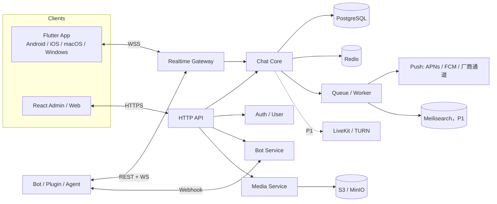

# 独立聊天平台（Agent-Native IM）开发设计文档

- 版本：0.1（待评审）
- 日期：2026-10-28
- 状态：只做设计与范围确认，尚未进入实现
- 代号：AgentChat（暂定，可换）

---

## 0. 结论摘要

1. **技术上可行，但“支持现有的一切”不能作为一期目标。** 微信/QQ 的“一切”是十年产品、生态和合规的叠加，一个小团队一期做完不现实。可行的做法是：做一个 **bot 优先、可自托管、API 开放** 的 IM，把现在 iLink 做不到的能力变成原生能力，再按阶段补齐社交功能。
2. **建议自研协议和核心服务，不套 Matrix/XMPP。** 你要的是“bot 能读、能写、能主动触达、能拿历史”，而 Matrix 的 E2EE 和联邦模型会直接和这个目标冲突；XMPP 的客户端体验和生态又太旧。
3. **技术选型：** 服务端 TypeScript（Fastify + PostgreSQL + Redis + S3/MinIO），四端用 Flutter 单代码库，管理后台用 React，协议用 REST + WebSocket + Webhook，OpenAPI 3.1 描述。
4. **工作量：** 2 名开发约 5–6 个月到“四端可用的 MVP”；1 人约 10–12 个月；对标微信全功能需要 2–3 年、5 人以上团队。
5. **最大风险不是技术，是范围、合规、推送通道和四端 QA。** 另外要接受一个现实：如果平台没有用户，功能再全也只是自用工具——这未必是坏事，但要在定位上说清楚。

---

## 1. 背景与目标

### 1.1 为什么要做

现有方案的能力边界已经很清楚：

- 微信 iLink：出站语音不投递、没有贴纸类型、群聊拿不到 @ 列表、没有历史漫游、不能主动触达陌生人、不能加好友/看通讯录。
- QQ 个人号 + NapCat：能力强，但违反腾讯用户协议，封号风险，依赖常驻设备。
- 官方机器人平台：合规稳定，但 bot 是独立身份，接口和审核受限，不能当“真人号”。

这些限制的共同点是：**平台方没有把“bot 作为一等公民”来设计**。所以换个思路——自己做一个聊天平台，协议自己定，bot 从第一天就是原生用户。

### 1.2 目标

- 一个可自托管的聊天服务端，开放 REST/WS/Webhook API，插件、脚本、Agent 都能接入。
- 四端客户端：Android、iOS、macOS、Windows，共享一套 Flutter 代码。
- 原生支持现在缺的能力：任意消息类型、出站语音、贴纸、结构化 @、历史、主动触达、引用/转发/位置/名片、多端同步。
- 人类用户和 bot 能在同一个会话里协作；bot 的权限可授权、可审计、可撤销。
- 先私有部署/小团队可用，再考虑公开运营。

### 1.3 非目标（一期明确不做）

- 不做公开社交网络，不和微信/QQ 抢用户。
- 不做支付、小程序、视频号、直播电商。
- 不做微信/QQ 桥接（桥接仍然要面对封号和协议逆向，和本项目的目标相悖）。
- 不做联邦（Federation）和端到端加密（E2EE）——至少一期不做，原因见 §11。
- 不做“无限扩容”的分布式架构；一期单机/双机足够。

> 一句话定位：**这不是“另一个微信”，是“Agent 的通信底座 + 人能用的 IM”。**

---

## 2. 产品定位与核心场景

### 2.1 定位

| 维度 | 选择 |
|---|---|
| 用户 | 自己、团队、私有部署客户；不是大众社交 |
| 部署 | 自托管优先（Docker Compose），后面再做云托管 |
| 差异化 | bot 原生 + 全消息类型 + 开放 API + 历史/主动触达 |
| 客户端 | 四端原生体验，Flutter 单代码库 |
| 商业模式（可选） | 开源自托管 + 企业版/托管版 |

### 2.2 核心场景

1. **个人 Agent 控制面**：在手机上给 Agent 发消息，Agent 能回语音、图片、文件、贴纸，能主动提醒，能查历史。
2. **团队 bot**：群里 @ bot 或私聊，bot 能读上下文、@ 人、发卡片、执行审批。
3. **系统通知**：CI、监控、IoT 通过 bot API 推到会话，支持分级和静默。
4. **跨端同步**：手机、电脑、平板同一个账号，消息/已读/草稿同步。
5. **私有客服/社区**：频道 + 线程 + 管理后台，数据在自己手里。

### 2.3 与现有项目的关系

`dsh-weixin` 不动。新平台是独立工程；在 DSH 侧只需要新增一个 transport 适配器（实现 `src/channel.js` 的契约），把 AgentChat 当成第二个渠道。iLink 继续作为微信渠道保留。

---

## 3. 能力对照：现在缺的，新平台怎么解

| 能力 | iLink 现状 | AgentChat 设计 |
|---|---|---|
| 出站语音 | ret=0 但不投递 | 原生 `voice` 消息类型，服务端转码 Opus/Ogg，客户端直接播 |
| 贴纸 | 协议无类型 | `sticker` 类型 + 贴纸包（服务端托管，客户端缓存） |
| 群 @ 列表 | 拿不到结构化信息 | 消息带 `mentions[]`，含被 @ 的用户/bot ID |
| 历史漫游 | 不支持 | 服务端全量存储，按会话 `seq` 增量同步 |
| 主动触达 | 不能找没聊过的人 | bot 可在用户授权/互动后主动发消息，有频控和退订 |
| 加好友/通讯录 | 不支持 | 好友申请 + 同意；通讯录只返回已同意关系 |
| 引用/转发/位置/名片 | 不支持 | 全部是 `type` + `payload` 的一等消息类型 |
| 朋友圈/视频号 | 不支持 | 二期 `feed` / `channel` 模块，独立于聊天 |
| 多端同步 | 依赖宿主 | 设备级 session + 游标同步 + 已读/草稿同步 |
| 开放 API | 受限 | REST + WS + Webhook + SDK，OpenAPI 描述 |
| 消息类型扩展 | 枚举写死 | 未知类型带 `fallback` 文本，客户端降级渲染 |

---

## 4. 功能范围与分期

### 4.1 P0：MVP（必须）

**账号与设备**
- 邮箱/手机号注册登录、OAuth（GitHub/Google，可选）
- 设备管理、会话列表、登出全部设备
- 个人资料、头像、在线状态

**会话与消息**
- 1:1 私聊、群聊（创建/邀请/退群/踢人/管理员）
- 文本、图片、文件、语音（录制/播放/转写可选）
- 回复/引用、@ 提及、表情回应（reaction）
- 已读回执、正在输入、消息撤回（时间窗可配）
- 会话置顶/免打扰/未读数
- 历史消息分页、按会话搜索
- 离线消息、断线重连、多端游标同步

**Bot 与开放能力**
- Bot 注册、token、权限 scope
- Bot 加入会话、收发消息、读历史、@ 人、发媒体
- Webhook 事件 + WebSocket 长连接两种接入
- TS SDK、OpenAPI 文档、沙箱环境
- 管理后台：用户/会话/Bot/审计/内容举报

**客户端**
- Flutter：Android、iOS、macOS、Windows
- 响应式布局，桌面快捷键，移动端推送
- 本地 SQLite 缓存 + 发件箱 + 增量同步

### 4.2 P1：完整体验（3–6 个月后）

- 视频消息、视频通话（1:1，WebRTC）
- 贴纸包、GIF、位置、名片、投票
- 消息编辑、转发、合并转发、收藏
- 频道（ broadcast ）、线程（ thread ）、话题标签
- 朋友圈/动态（feed）、点赞/评论
- 全文搜索（Meilisearch）、消息翻译
- Bot 商店/模板、Python SDK、OAuth 应用
- 多租户（组织/工作区）、邀请链接、域名白名单
- 端到端加密试点（仅人类对人类的私聊，bot 不参与）

### 4.3 P2：生态与规模化

- 群通话/直播（SFU：LiveKit/mediasoup）
- 小程序/插件市场（受限沙箱）
- 支付/红包（如确有场景）
- 联邦（多实例互通）
- 完整 E2EE（MLS）、多设备密钥同步
- 内容推荐/算法（如做公开社区）
- 跨平台桥接（微信/QQ/Telegram/Discord，风险自担）

> 这张表就是“所有功能”的真实含义：**不是一期全做，而是每一项都有位置、有阶段、有取舍。**

---

## 5. 总体架构



### 5.1 架构原则

- **模块化单体优先**：一个服务端进程 + 一个 worker，按模块分目录；到瓶颈再拆服务。不要一上来微服务。
- **PostgreSQL 是事实源**：消息、会话、权限都在 PG；Redis 只做缓存、在线状态、限流、Pub/Sub。
- **写路径单写**：每个会话的消息序号由 PG 分配，避免多节点乱序。
- **读路径可缓存**：会话列表、成员、未读数走 Redis；消息正文不缓存，直接查 PG。
- **媒体走对象存储**：客户端拿预签名 URL 直传，服务端只做元数据、转码、扫描。
- **同步靠游标**：客户端带 `since` 拉增量，WS 只做实时推送，断了用 REST 补。

### 5.2 技术栈

| 层 | 选择 | 理由 |
|---|---|---|
| 语言 | TypeScript / Node 22 | 和 DSH 插件生态一致，SDK 复用 |
| HTTP | Fastify | 轻、快、schema 友好 |
| ORM | Drizzle | SQL 可控，迁移简单 |
| 数据库 | PostgreSQL 16 | JSONB、全文搜索、可靠事务 |
| 缓存/队列 | Redis + BullMQ | 在线状态、限流、推送重试 |
| 对象存储 | MinIO（自托管）/ S3 | 预签名上传，便宜 |
| 实时 | ws（`ws` 库） | 自建网关，协议可控 |
| 媒体处理 | ffmpeg + sharp | 语音转码、缩略图、视频转码 |
| 推送 | APNs + FCM + 国内厂商 | 见 §10.3 |
| 部署 | Docker Compose + Caddy | 自托管一键起 |
| 可观测 | OpenTelemetry + Prometheus + Grafana + Sentry | 日志/指标/追踪 |

> 如果团队更熟 Go，服务端换 Go 也成立；但 SDK、协议生成、和 DSH 的复用会少一些。**一期不建议多语言。**

---

## 6. 协议与 API 设计

### 6.1 设计原则

- API-first：先写 OpenAPI 3.1，再生成 SDK 和客户端模型。
- 版本化：路径 `/v1`，破坏性变更走 `/v2`，旧版本至少保留 12 个月。
- 幂等：所有写操作支持 `Idempotency-Key`；消息额外带 `client_msg_id`。
- 游标同步：不用时间戳做同步边界，用每会话单调递增 `seq`。
- 事件不可变：消息编辑/撤回产生新事件，客户端按 `seq` 应用。
- 错误统一：`{ "error": { "code": "...", "message": "...", "details": {...} } }`。

### 6.2 认证

- 用户：邮箱/手机号 + 密码（Argon2id），或 OAuth；登录返回 access token（短期）+ refresh token（长期，设备绑定）。
- Bot：`Authorization: Bearer <bot_token>`；token 只在创建时显示一次，服务端存哈希。
- 设备：每个设备一个 `device_id` + 公钥（用于推送加密/多端校验），可单独撤销。
- 管理后台：独立角色（owner/admin/moderator），支持 2FA。

### 6.3 消息信封

所有消息统一为一个 JSON 信封，`type` 决定 `payload` 的形状；未知类型必须带 `fallback`。

```json
{
  "id": "msg_01J9Z6Q3K8",
  "conversation_id": "conv_01J9Z5A1",
  "seq": 1024,
  "client_msg_id": "c_8f2a1b",
  "sender": { "type": "bot", "id": "bot_01J9Z4" },
  "type": "voice",
  "payload": {
    "object_key": "media/2026/10/u_01J9/abc.ogg",
    "duration_ms": 3200,
    "waveform": [12, 40, 33, 51],
    "transcript": "你好，我看一下"
  },
  "mentions": [{ "type": "user", "id": "usr_01J9Z3" }],
  "reply_to": "msg_01J9Z6P0",
  "created_at": "2026-10-28T15:22:00Z",
  "edited_at": null,
  "fallback": "[语音 3.2s]"
}
```

P0 支持的 `type`：`text`、`image`、`file`、`voice`、`system`、`sticker`（P1 可提前）、`video`（P1）。
P1 增加：`location`、`contact`、`poll`、`forward`、`card`。

### 6.4 REST 端点（节选）

| 方法 | 路径 | 说明 |
|---|---|---|
| POST | `/v1/auth/register` `/v1/auth/login` `/v1/auth/refresh` | 账号 |
| GET | `/v1/users/me` `/v1/users/{id}` | 资料 |
| GET | `/v1/conversations` | 会话列表（带未读/最后消息） |
| POST | `/v1/conversations` | 创建私聊/群 |
| GET | `/v1/conversations/{id}/messages?before_seq=&limit=` | 历史分页 |
| POST | `/v1/conversations/{id}/messages` | 发消息 |
| PATCH | `/v1/messages/{id}` | 编辑 |
| DELETE | `/v1/messages/{id}` | 撤回 |
| POST | `/v1/messages/{id}/reactions` | 表情回应 |
| POST | `/v1/conversations/{id}/read` | 已读游标 |
| GET | `/v1/sync?since=<cursor>&limit=500` | 增量同步 |
| POST | `/v1/media` | 申请预签名上传 |
| GET | `/v1/search?q=&conversation_id=` | 搜索（P0 用 PG FTS） |
| POST | `/v1/bots` | 注册 bot |
| POST | `/v1/bots/{id}/install` | 加入会话（管理员授权） |
| GET | `/v1/bots/{id}/audit` | bot 操作审计 |

### 6.5 WebSocket 协议

连接：`wss://host/v1/ws?token=...&device_id=...`

```json
{"op":"hello","resume":{"conv_01J9Z5A1":1024}}
{"op":"event","event":"message.created","seq":1025,"data":{...}}
{"op":"ack","seq":1025}
{"op":"ping"}
```

事件类型：`message.created`、`message.updated`、`message.deleted`、`reaction.updated`、`receipt.updated`、`typing`、`presence`、`conversation.updated`、`member.updated`、`bot.installed`。

- 服务端按设备维护订阅；只推该用户可见的会话。
- 客户端检测 `seq` 缺口，自动走 `/v1/sync` 补齐。
- 连接断开指数退避重连；`resume` 带各会话最后 `seq`。

### 6.6 Webhook（Bot 出站）

- Bot 可注册 `webhook_url`，也可用 WS 长连接（二选一，推荐 WS）。
- 请求头：
  - `X-Chat-Event: message.created`
  - `X-Chat-Delivery: evt_...`
  - `X-Chat-Signature: t=<unix>,v1=<HMAC_SHA256(secret, t + "." + raw_body)>`
- 验签 + 5 分钟时间窗防重放；失败按 1s/5s/30s/5m/30m 重试，最多 24 小时。
- 幂等：同一 `X-Chat-Delivery` 只处理一次。
- 出站请求做 SSRF 防护：禁止内网地址、限制端口、解析后校验 IP。

### 6.7 Bot 权限与频控

Scope（安装到会话时由管理员勾选）：

| Scope | 含义 |
|---|---|
| `messages:read` | 读会话消息（可限定“仅 @ 我”） |
| `messages:write` | 发消息 |
| `history:read` | 读加入前的历史（需额外授权） |
| `members:read` | 读成员列表 |
| `reactions:write` | 加/删表情回应 |
| `media:write` | 发媒体 |
| `proactive:write` | 主动发起会话 |
| `contacts:read` | 读好友关系（仅自己 owner 的） |

频控：
- 每 bot 每会话 20 条/分钟，全局 200 条/分钟（可配）。
- 主动消息：每用户每天最多 5 条，且必须满足“用户先互动过”或“用户显式订阅”。
- 群内默认“仅响应 @”，管理员可开“读全部”。

---

## 7. 数据模型

```
users(id, handle, display_name, avatar_key, email_hash, phone_hash, status, created_at)
devices(id, user_id, platform, name, push_token, public_key, last_seen_at, revoked_at)
sessions(id, user_id, device_id, token_hash, refresh_hash, expires_at, created_at)
conversations(id, type, title, avatar_key, owner_id, settings_jsonb, created_at)
conversation_members(conversation_id, principal_type, principal_id, role,
                      joined_at, mute_until, last_read_seq, last_delivered_seq)
messages(id, conversation_id, seq, sender_type, sender_id, type, payload_jsonb,
         reply_to, client_msg_id, created_at, edited_at, deleted_at)
message_mentions(message_id, principal_type, principal_id)
attachments(id, message_id, object_key, mime, size, width, height, duration_ms,
            sha256, scan_status, created_at)
reactions(message_id, principal_type, principal_id, emoji, created_at)
receipts(conversation_id, principal_type, principal_id, last_read_seq, updated_at)
bots(id, owner_id, name, avatar_key, token_hash, scopes_jsonb, webhook_url, status)
bot_installs(bot_id, conversation_id, scopes_jsonb, installed_by, created_at)
webhook_deliveries(id, bot_id, event_id, status, attempts, next_retry_at)
audit_logs(id, actor_type, actor_id, action, target_type, target_id, metadata_jsonb, created_at)
invites(code, conversation_id, created_by, expires_at, max_uses)
```

关键约束：

- `messages(conversation_id, seq)` 唯一；`seq` 由 `conversations.next_seq` 原子递增分配。
- `messages(conversation_id, created_at desc)` 索引用于历史分页。
- `client_msg_id` 在会话内唯一，用于幂等。
- 软删除：`deleted_at` + 事件；客户端收到 `message.deleted` 后移除正文。
- 附件与消息分离，支持一个消息多个附件。
- 审计日志只追加，不更新。

分区策略（P1 再做）：`messages` 按月/按 `conversation_id` hash 分区；一期单表 + 索引足够。

---

## 8. 服务端模块

```
apps/server/src/
  modules/auth/          # 注册、登录、token、设备
  modules/users/         # 资料、隐私设置、好友
  modules/conversations/ # 会话、成员、邀请、权限
  modules/messages/      # 发送、编辑、撤回、回应、已读
  modules/sync/          # 游标同步、增量查询
  modules/gateway/       # WebSocket、在线状态、事件分发
  modules/media/         # 预签名、转码、扫描、缩略图
  modules/bots/          # bot 注册、安装、webhook、审计
  modules/notifications/ # 推送、免打扰、聚合
  modules/moderation/    # 举报、屏蔽、内容审核
  modules/admin/         # 后台接口
  modules/search/        # PG FTS（P1 换 Meilisearch）
  lib/                   # db、redis、队列、日志、错误、配置
```

### 8.1 发送消息的事务边界

1. 校验权限、限流、幂等键。
2. `BEGIN`：分配 `seq`、插入 `messages`、更新会话 `last_message`、插入 `mentions`/`attachments`。
3. `COMMIT`。
4. 写 outbox（同事务）→ worker 投递 WS 事件、推送、webhook。
5. 返回消息体 + `seq`。

> 用 outbox 保证“入库成功但事件丢了”不会发生；worker 至少一次投递，客户端按 `seq` 去重。

### 8.2 在线状态

- Redis `presence:{user_id}` 存连接数与最后心跳，TTL 60s。
- 多设备取“任一在线即在线”；客户端可配置“仅手机在线时推送”。
- 状态变更走 WS 广播，限流合并（1s 窗口）。

### 8.3 媒体管线

1. 客户端 `POST /v1/media` 申请上传，服务端返回预签名 URL + `media_id`。
2. 客户端直传 S3/MinIO。
3. 客户端发消息引用 `media_id`；服务端校验归属、大小、MIME。
4. worker 异步：病毒扫描（ClamAV）、图片缩略图、语音转 Opus、视频转 H.264/HLS、EXIF 清理。
5. 扫描未通过的媒体标记 `blocked`，消息带 `fallback`。

限制：图片 20MB、文件 200MB、语音 5 分钟、视频 500MB（可配）。

---

## 9. 客户端设计

### 9.1 技术选型对比

| 方案 | 优点 | 缺点 | 结论 |
|---|---|---|---|
| Flutter 单代码库 | 四端一套 UI/逻辑；桌面支持成熟；性能稳定 | Dart 生态比 TS 小；桌面细节要自己磨 | **推荐** |
| React Native + Tauri | 复用 TS；Web 生态大 | 两套技术栈；桌面/移动体验差异；原生模块多 | 团队全是 TS 时可选 |
| Kotlin Multiplatform | 原生性能；共享逻辑 | iOS/桌面 UI 仍需分别写 | 不推荐小团队 |
| 四端分别原生 | 体验最好 | 成本 4 倍 | 不现实 |

**建议：Flutter 一个工程，四个 target；管理后台和 Web 用 React。**

### 9.2 客户端结构

```
apps/app/lib/
  core/          # 协议模型、HTTP、WS、加密、配置
  data/          # drift 数据库、DAO、同步引擎、发件箱
  features/      # auth、chat、conversations、contacts、settings、bots
  ui/            # 主题、组件、响应式布局
```

- 状态管理：Riverpod（或 Bloc）。
- 本地库：drift（SQLite），消息按 `conversation_id + seq` 存。
- 同步：启动时 `/v1/sync` 拉增量；WS 实时事件按 `seq` 应用；缺口触发补拉。
- 发件箱：本地先落 `pending`，拿到服务端 `id/seq` 后替换；失败重试 + 手动重发。
- 媒体：下载缓存 + 缩略图 + 断点续传；发送前压缩。
- 语音：`record` 录音（AAC/Opus）→ 上传 → 服务端转码；播放用 `just_audio`。
- 视频：`video_player`；P1 加 HLS。
- 通话：`flutter_webrtc` + 自建 TURN；P1 只做 1:1。
- 桌面：`window_manager`、`tray_manager`、`auto_updater`、原生通知；快捷键（Cmd/Ctrl+K 搜索、Esc 关闭）。
- 移动：后台受限，依赖推送唤醒；iOS 不做常驻 WS。

### 9.3 四端差异

| 端 | 重点 |
|---|---|
| Android | 厂商推送（国内）、后台保活、文件选择、录音权限 |
| iOS | APNs、后台刷新限制、相册/麦克风权限、审核（UGC 需举报/屏蔽） |
| macOS | 菜单栏、通知中心、沙箱签名、公证（notarization） |
| Windows | 托盘、开机自启、Toast 通知、代码签名、自动更新 |

### 9.4 推送

- iOS/macOS：APNs（token-based auth）。
- Android 海外：FCM；国内：华为/小米/OPPO/vivo/荣耀推送，建议接聚合服务或自建适配层。
- Windows：WS 在线时走本地 Toast；离线用 WNS 或不保证。
- 推送内容只带 `conversation_id` + 摘要，不带敏感正文；客户端拉取后解密/展示。
- 免打扰、聚合（同一会话 5 分钟内合并）、静默时段。

---

## 10. Bot 与插件体系

### 10.1 Bot 是一等公民

- Bot 有独立 `bot_id`、头像、资料，可被加入会话。
- Bot 不是“用户”，但共享 `principal` 抽象（`user` / `bot`），消息 sender、mention、reaction 都支持两种类型。
- Bot 的权限在安装时授予，管理员可随时撤销；所有敏感操作写审计。

### 10.2 SDK 示例（TypeScript）

```ts
import { Bot } from "@agentchat/sdk";

const bot = new Bot({
  baseUrl: "https://chat.example.com",
  token: process.env.CHAT_BOT_TOKEN!,
});

bot.on("message.created", async (msg) => {
  if (msg.type !== "text") return;
  if (!msg.mentions.some((m) => m.id === bot.id)) return;
  await bot.reply(msg, { type: "text", payload: { text: "收到" } });
});

await bot.connect(); // WS，自动重连
```

### 10.3 DSH 适配器

新增 `src/transports/agentchat.js`，实现现有 `Channel` 契约：

```js
class AgentChatTransport {
  capabilities = { text: true, media: true, typing: true, voice: true, stickers: true };

  async sendText(conversationId, text) { /* POST /v1/.../messages */ }
  async sendMedia(conversationId, media) { /* 先上传，再发消息 */ }
  async setTyping(conversationId, on) { /* WS typing */ }
  onMessage(handler) { /* WS message.created -> handler */ }
}
```

这样 `dsh-weixin` 的出站分片、outbox、白名单、session bridge 都能复用；新平台只是“第二个 transport”。

### 10.4 Bot 商店（P1）

- Bot 模板：欢迎语、命令、权限最小集。
- 安装链接：`https://chat.example.com/add-bot?bot=...&conversation=...`。
- 审核：公开上架需要审核；私有 bot 不审核。

---

## 11. 安全、隐私与合规

### 11.1 基础安全

- 全站 TLS 1.3；HSTS；Web 端 CSP。
- 密码 Argon2id；token 只存哈希；refresh token 轮换。
- 登录风控：失败次数、异地提醒、设备列表、2FA。
- 限流：IP + 用户 + bot 三维度；Webhook 出站防 SSRF。
- 媒体：预签名 URL 短 TTL；病毒扫描；图片重编码去 EXIF。
- 审计：bot 操作、管理员操作、敏感数据访问。
- 备份：PG 每日全量 + WAL；对象存储版本化；恢复演练。

### 11.2 E2EE 的取舍（重要）

**bot 优先和 E2EE 天然冲突。** 如果服务端看不到明文，bot 就读不到消息，搜索、历史、主动回复也做不了。

建议：

- 一期：传输 TLS + 服务端静态加密（磁盘/对象存储），**不做 E2EE**。
- 二期：只对“人类对人类的私聊”提供可选 E2EE（MLS/Signal 协议），该会话不支持 bot、搜索、服务端转写；UI 明确提示。
- 群聊默认不 E2EE；如要做，需接受 bot 被排除。

> 如果目标是“Agent 能读能写”，就不要把 E2EE 当默认；把它当“隐私模式”而不是“全站默认”。

### 11.3 合规（中国大陆）

如果只是自用/内部部署，主要是软件分发和数据安全；**一旦公开运营**，至少涉及：

- ICP 备案（非经营性）/ ICP 许可证（经营性，视收费模式）；
- 公安联网备案；
- 用户实名（手机号）；
- 内容审核、举报、屏蔽、未成年人保护；
- APP 备案（工信部）、应用商店审核（UGC 类目）；
- 隐私政策、个人信息保护（PIPL）、数据出境评估（如适用）；
- 算法备案（如做推荐）。

> 这些不是“上线后再补”的项，公开运营前需要法务确认。文档只列清单，不构成法律意见。

### 11.4 滥用与垃圾信息

- 新账号限制：不能批量加好友、不能高频群发。
- Bot 主动消息必须“用户先互动/显式订阅”，带一键退订。
- 举报 → 管理员队列 → 封禁/限流；保留证据。
- 关键词/图片审核（可接云服务或本地模型），命中后进审核队列。

---

## 12. 性能与容量

### 12.1 目标

| 指标 | 一期目标 |
|---|---|
| 注册用户 | 10 万 |
| DAU | 1 万 |
| 峰值消息 | 200 条/秒 |
| 消息投递 p99 | < 200ms（同区域） |
| 历史分页 | < 150ms（50 条/页） |
| 可用性 | 99.5%（单机 + 备份） |

### 12.2 容量估算

- 1 万 DAU × 100 条/天 = 100 万条/天 ≈ 12 条/秒均值，峰值按 20 倍 ≈ 240 条/秒。
- 单条消息 + 索引约 1–2KB → 每天 1–2GB；一年 0.5–1TB（含媒体另算）。
- 单台 8C16G PG + 2 台 4C8G 应用 + MinIO 足够。

### 12.3 扩展路径

1. 读写分离：PG 只读副本承接历史/搜索。
2. 消息分区：按月 + `conversation_id` hash；冷数据归档。
3. WS 网关分片：按 `user_id` hash，Redis Pub/Sub 跨节点广播。
4. 媒体 CDN：图片/视频走 CDN，预签名下载。
5. 搜索独立：Meilisearch/OpenSearch。
6. 多租户：按 `tenant_id` 隔离，独立库或 schema。

---

## 13. 仓库结构（独立工程）

```
agentchat/
  apps/
    server/            # Fastify + TS
    app/               # Flutter，android/ios/macos/windows
    admin/             # React + Vite
  packages/
    protocol/          # OpenAPI + JSON Schema + 生成代码
    sdk-ts/            # Bot/客户端 SDK
    sdk-python/        # P1
    dsh-adapter/       # 接入 DSH 的 Channel 适配器
    ui-kit/            # 可选：设计系统
  infra/
    docker-compose.yml
    caddy/
    grafana/
  docs/
    design.md          # 本文
    api.md
    self-hosting.md
  LICENSE
```

- 包管理：pnpm workspace（TS 部分）+ Flutter 自己的 `pubspec`。
- CI：lint + typecheck + 单测 + OpenAPI 校验 + Flutter analyze/test + 构建四端。
- 许可证建议：服务端 AGPL-3.0（防止闭源托管），SDK/协议 MIT/Apache-2.0；客户端 GPL/AGPL 可选。**上线前定，不要事后改。**

---

## 14. 路线图与工作量

### 14.1 里程碑

| 阶段 | 内容 | 2 人 | 1 人 |
|---|---|---|---|
| M0 | 协议/OpenAPI、仓库骨架、CI、认证、WS echo | 2 周 | 3 周 |
| M1 | 服务端核心（会话/消息/媒体/同步/推送）+ Flutter 文本图片语音 + 管理后台 | 8 周 | 14 周 |
| M2 | 群聊/@/回应/搜索/历史 + Bot API/SDK/Webhook + DSH 适配 + 四端 beta | 8 周 | 14 周 |
| M3 | 1:1 通话、贴纸、视频、频道/线程、审核、E2EE 试点 | 10–12 周 | 16–20 周 |
| M4 | 朋友圈、群通话、多租户、联邦、规模化 | 持续 | 持续 |

**结论：2 人约 5–6 个月到 M2（四端可用 MVP）；1 人约 10–12 个月。** 这是“能日常用”的水平，不是“微信级稳定”。

### 14.2 成本（不含人力）

| 项 | 估算 |
|---|---|
| 服务器（2 台 + 对象存储） | $50–200/月 |
| 域名 + TLS | $20/年 |
| Apple Developer | $99/年 |
| Google Play | $25 一次性 |
| Windows 代码签名 | $100–400/年 |
| 推送聚合/短信 | 按量，$20–100/月 |
| TURN 带宽（P1） | 按量，$20–200/月 |

### 14.3 建议的推进顺序

1. 先做 **server + Web 管理端 + 桌面客户端**（macOS 优先，你在 macOS 上开发）。
2. 跑通 bot SDK 和 DSH 适配器，验证“Agent 能读能写能主动发”。
3. 再做 Android/iOS（推送、审核、后台限制是另一类工作）。
4. 最后做通话、朋友圈、频道这些“重但非核心”的模块。

---

## 15. 风险与备选方案

### 15.1 主要风险

| 风险 | 影响 | 缓解 |
|---|---|---|
| 范围失控（“一切”） | 永远上不了线 | 锁定 P0，P1/P2 进 backlog；每期只加 3 个功能 |
| 四端 QA 成本 | 发版慢、bug 多 | Flutter 单代码库；桌面先行；移动端分批 |
| 推送/后台限制 | 消息不及时 | APNs/FCM/厂商通道；WS 在线；推送只做唤醒 |
| 合规 | 无法上架/被下架 | 公开运营前法务；先私有部署 |
| E2EE 与 bot 冲突 | 架构返工 | 一期不做 E2EE；隐私模式单独设计 |
| 网络效应 | 没人用 | 定位为自用/团队工具，不追大众 |
| 安全漏洞 | 数据泄露 | 审计、渗透测试、依赖扫描、最小权限 |
| 维护成本 | 长期拖累 | 模块化单体、自动化、可观测、备份演练 |

### 15.2 备选方案

| 方案 | 优点 | 代价 | 适用 |
|---|---|---|---|
| **自研（推荐）** | 完全控制；bot 原生；可按需裁剪 | 5–6 个月 MVP | 目标是 Agent 通信底座 |
| Fork OpenIM | Go 服务端成熟、SDK 多 | 代码量大、定制/升级成本 | 时间优先、能接受 Go |
| Matrix | 联邦、E2EE、现成客户端 | 重；bot 受 E2EE 限制；运维复杂 | 需要联邦/去中心化 |
| Revolt / Mattermost | TS/成熟 Web、插件体系 | 移动端弱；bot 能力有限 | 团队协作而非 Agent |
| XMPP | 标准、扩展多 | 客户端体验旧、开发慢 | 极客/特定集成 |

> 如果 3 个月内必须上线，优先评估 Fork OpenIM；如果要长期掌控协议和 bot 体验，自研。

---

## 16. 待确认问题（需要你拍板）

1. **定位**：只自己/团队用，还是公开运营？——决定合规章节是“清单”还是“前置条件”。
2. **首发端**：四端必须同时发，还是先 macOS/Windows + Web，Android/iOS 晚 2–3 个月？
3. **E2EE**：是否接受“默认服务端可读、隐私模式才 E2EE”？如果要求全站 E2EE，bot 读取历史/主动回复就要重新设计。
4. **互通**：要不要和微信/QQ/Telegram 桥接？桥接会重新引入封号和协议逆向风险。
5. **人力/预算**：1 人、2 人还是小团队？有没有 iOS/Android 上架经验？
6. **命名/许可证**：项目名、开源协议、是否商业托管。

---

## 17. 一页纸决策建议

- **做**：bot 优先、自托管、开放 API 的 IM；先把“Agent 能读能写能主动发”跑通。
- **不做**：一期不做 E2EE、不做联邦、不做支付/小程序、不做微信桥接。
- **技术**：TS 服务端 + PG/Redis/S3；Flutter 四端；React 管理台；REST + WS + Webhook。
- **节奏**：2 人 5–6 个月到四端 MVP；先桌面 + 服务端 + bot SDK，再移动端。
- **成败关键**：范围控制、推送通道、合规、四端体验；不是协议本身。

---

*本文是设计草案，不是最终规格。确认定位和范围后，再拆成 API 规范、数据字典和迭代计划。*
